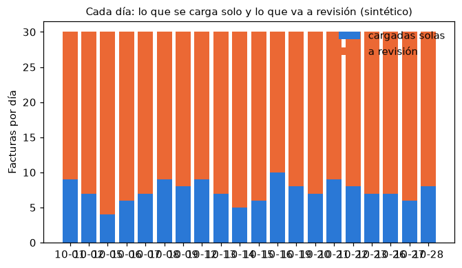
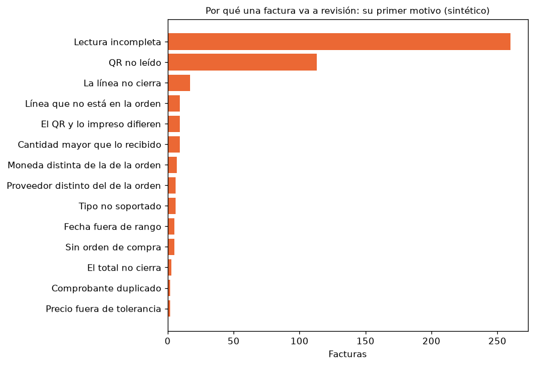
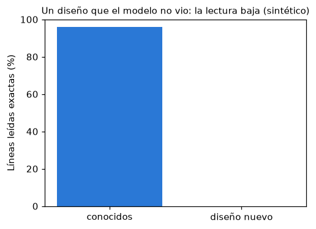
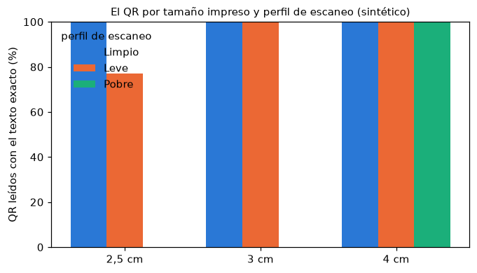
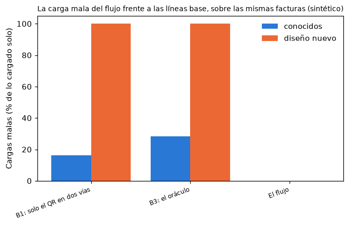
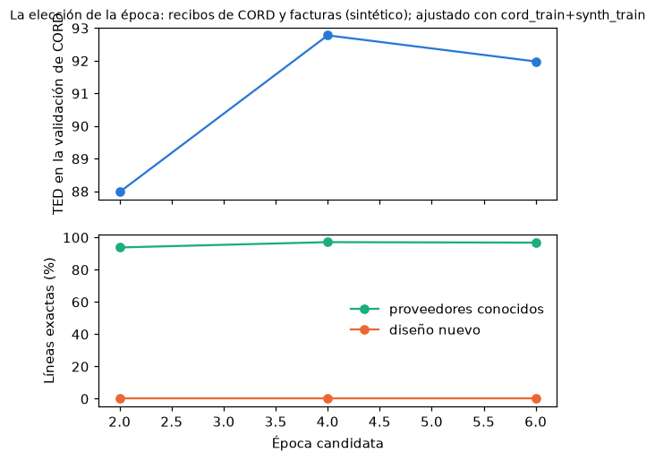
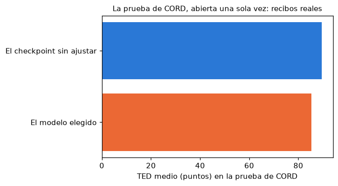

# ¿Es automatizable la carga de facturas al ERP con Donut, QR y cruce de tres vías?

[English](README.md) · **Español**

| | |
| --- | --- |
| **Propuesta de valor** | Carga automática de facturas de proveedores al ERP, con cruce de tres vías: cada factura se lee, se ancla en el QR de ARCA, se cruza con la orden de compra y con el remito, y solo se carga la que cierra |
| **Stack tecnológico** | Python 3.11, PyTorch y Transformers (Donut), pyzbar y OpenCV, pandas y PyArrow (Parquet), SQLite, FastAPI y httpx, pytest, Apache Airflow sobre Docker Compose, y el diseño de un tablero de Power BI en HTML |
| **Técnicas** | Comprensión de documentos con un modelo ajustado (Donut), lectura y validación del QR de ARCA, coincidencia de dos y de tres vías con reglas explícitas, líneas base B0 a B3, intervalos de Wilson y remuestreo pareado, prueba sellada que se lee una sola vez |
| **Para auditar** | [Ficha del modelo](docs/model-card.md) · [Evaluación independiente](docs/evaluation.md) · [Resultados de la evaluación](reports/evaluation_summary.md) · [Registro de decisiones](docs/decisions.md) |

Este README sigue la estructura común de los proyectos de datos del portafolio, descrita en `ESTRUCTURA-PROYECTOS.md` en la raíz del portafolio.

## 1. Resumen ejecutivo

### 1.1 Problema de negocio y solución

Un flujo que lee cada día las facturas de proveedores de un distribuidor, ancla su cabecera en el QR de ARCA, las cruza con la orden de compra y con el remito, y carga como borrador en el ERP solo las que cierran; el resto va a revisión con su motivo. Las facturas son **sintéticas**: las genera el proyecto con el formato del QR de ARCA, porque no hay un conjunto público de facturas argentinas con sus órdenes y remitos. Lo único real son 1.000 recibos de CORD (Clova AI, CC BY 4.0), que sirven para medir si el modelo de documentos ajustado olvida lo que ya leía.

**El problema.**

Cuentas a pagar recibe facturas en PDF o en imagen y alguien las tipea en el ERP: lee el proveedor, el CUIT, el número, las líneas y el total, busca la orden de compra, comprueba contra lo que el depósito recibió y carga. Es lento y se equivoca justo donde cuesta: un precio un poco más alto que el de la orden, más cantidad que la recibida, una factura que se carga dos veces. Para automatizarlo hace falta algo más que leer la imagen: cargar solo lo que cierra y no cargar mal.

Los datos tienen un límite que el proyecto dice desde el principio. CORD trae recibos reales de comercios de Indonesia, con las líneas, el subtotal, el impuesto y el total, **pero sin proveedor, CUIT, fecha, punto de venta, número ni moneda**: ningún ajuste sobre CORD enseña esos campos. Por eso las facturas, las órdenes, los remitos, los proveedores y los CUIT son sintéticos, y toda cifra que sale de ellos lo dice. Un modelo que lee bien facturas que un generador propio dibuja no demuestra que lea las de una empresa: es una medición del flujo, no una promesa.

**La solución.**

Un flujo de trece tareas que simula la operación sobre facturas sintéticas: un lanzamiento (`L2026-09-30`) que ajusta el modelo y lo sella, 20 entregas diarias de 30 facturas (`D2026-10-01` a `D2026-10-28`, días hábiles) y un cierre (`C2026-10-29`) que evalúa la prueba una sola vez. En cada día lee las facturas con el modelo, lee el QR, cruza con el ERP, decide y carga las que cierran. Lo emitido no se rehace.

Cuatro piezas hacen el trabajo:

1. **Un modelo de documentos ajustado.** Donut (`donut-base-finetuned-cord-v2`, licencia MIT) se ajusta con 800 recibos de CORD y 2.000 facturas sintéticas, repasando CORD en cada época para no olvidarlo. De las épocas candidatas (2, 4 y 6) se elige una con una regla fijada antes: no perder más de 2,0 puntos de TED frente al propio checkpoint en CORD y, entre las que quedan, la que mejor lee las líneas de dos validaciones sintéticas. Salió la época 4.
2. **El QR de ARCA como ancla.** El QR trae el CUIT del emisor, la fecha, el punto de venta, el número, el importe y la moneda; el flujo lo lee con pyzbar (y OpenCV Aruco como respaldo), valida sus 13 campos contra la especificación y compara lo impreso con lo que dice. Una factura sin QR leído y válido nunca se carga sola.
3. **El cruce de dos y tres vías.** Compara el proveedor, las líneas, los precios y las cantidades con la orden de compra y con lo recibido en los remitos, con tolerancias en la configuración (2 % del precio unitario, ninguna cantidad por encima de lo recibido, 0,01 de redondeo por línea), y da un motivo entre 18 en un orden fijo. Es una regla explícita, no un modelo.
4. **La carga en el ERP.** Un borrador por factura, idempotente por proveedor y número, con lectura de vuelta de cada campo. El ERP de la suite es un sustituto local con la forma de la API de ERPNext; una prueba de humo corrió una vez contra ERPNext v15.124.4 real.

El resultado central no es un modelo sino una medición. Se compara con criterios C01-C10 fijados antes de construir, con lo esperable escrito por adelantado (que C03 probablemente no se cumpliría), y se sella: la prueba sintética se genera después del sello del lanzamiento y se evalúa una sola vez, y la prueba de CORD se abre una sola vez, en el cierre. La orquestación diaria es un DAG de Apache Airflow en Docker (`invoiceflow_daily`), como en los proyectos 01 a 06, por decisión del dueño (D26); el correo como disparador y el aviso a cuentas a pagar no se construyeron. El resultado salió desfavorable en cinco de los nueve criterios con umbral: no se cumple C01, C03, C04, C05 ni C06 (ver [5.1](#51-evaluación-frente-a-criterios-de-éxito)).

**Para qué sirve.**

- **Cuentas a pagar** ve, para cada factura, si el flujo la cargó o la mandó a revisión y por qué motivo, de 18 posibles; revisa solo lo que no cierra. Lo medido es sintético: no dice cuánto cargaría de las facturas de una empresa real.
- **Compras y depósito** ven por qué se frenó una factura: un precio fuera de la orden, más cantidad que la recibida, una orden que no existe.
- **Quien trabaje con documentos** ve cómo se evalúa un modelo de documentos con datos propios sin engañarse: la prueba se genera después del sello, los diseños de la prueba no se ven antes, y cada cifra dice con qué se ajustó su modelo.
- **Para un tablero:** las tablas en estrella y el diseño en HTML dicen cómo armar las páginas en Power BI Desktop.

Lo que no sirve: cargar sin revisión facturas de un diseño nuevo, leer los resultados sintéticos como los de una empresa, usar el QR generado como si ARCA lo hubiera emitido, ni leer PDF con texto o de varias páginas (van a cuarentena).

### 1.2 Criterios de éxito e impacto

Los criterios C01 a C10 se fijaron antes de construir ([docs/requirements.md](docs/requirements.md), sección 8.1), con lo que se esperaba de cada uno escrito por adelantado. Cada criterio contra su resultado, en [5.1](#51-evaluación-frente-a-criterios-de-éxito); el resumen sellado completo, en [Resultados completos de la evaluación](#resultados-completos-de-la-evaluación).

Lo que el proyecto encontró, medido una sola vez sobre la prueba y bajo un sello, con cifras sintéticas salvo C01 (de los nueve criterios con umbral se cumplen cuatro: C02, C07, C08 y C09; **no se cumple** C01, C03, C04, C05 ni C06):

- **Lee bien lo que ya conoce y no lee lo que no vio.** C02 se cumple: el 95,9 % de las líneas de facturas sintéticas de proveedores conocidos se lee exacto (intervalo del 95 %, 94,6 a 96,8). C03 no se cumple: el 0 % de las líneas sintéticas de un diseño de factura nuevo (intervalo del 95 %, 0,0 a 0,3), contra un umbral de 80 %. Era lo esperable.
- **No carga mal, pero la prueba no alcanza para decirlo con certeza** (C05 no se cumple): de 147 cargas automáticas sintéticas, ninguna fue mala; el límite superior de Wilson es 2,5 % y el máximo era 2 %. Con 147 cargas ningún resultado lo cumplía: hacían falta al menos 189 cargas automáticas. Se esperaba que se cumpliera.
- **Carga sola menos de lo pedido** (C06 no se cumple): el 69,7 % (147 de 211) de las facturas sintéticas limpias de proveedores conocidos se cargó solo y bien, contra el 85 % que se pedía. El QR de las facturas sintéticas se lee en el 83,1 % (487 de 586) de las impresas con QR intacto, contra el 97 % (C04 no se cumple): con un QR pequeño y un escaneo malo, ningún lector lo ve.
- **El cruce de tres vías ataja lo que el QR solo no ve** (C07, C08 y C09 se cumplen): 167 de 167 facturas sintéticas con una discrepancia sembrada fueron a revisión; solo con el QR en dos vías (B1) se cargaron mal 46 de las 600 facturas sintéticas de la prueba y con el flujo ninguna, 7,7 puntos por factura (intervalo del 95 %, 5,7 a 10,0), lo que se selló; por carga, como lo fija el preregistro, B1 cargó mal el 23,4 % de sus 197 cargas sintéticas y el flujo el 0 % de sus 147, una diferencia de 23,4 puntos (de 17,5 a 29,8), calculada después del sello (D59); y las 147 cargas sintéticas se leyeron de vuelta del ERP iguales a lo decidido, sin duplicar al repetir el último día.
- **El ajuste olvida algo de CORD** (C01 no se cumple, y se esperaba que se cumpliera): en la prueba de CORD, 100 recibos reales, el modelo elegido tiene TED 85,4 contra 89,6 del checkpoint sin ajustar; la diferencia es −4,2 (intervalo del 95 %, −6,6 a −2,0), con un piso de −2,0 puntos.
- **El cierre sellado tardó 1.032 s contra un límite de 10 minutos** (RNF02, no se cumplió): el 86 % era la lectura del checkpoint sobre las 600 páginas sintéticas para la línea base B2, de a una. Leyéndolas de a ocho, con los mismos árboles (D61), el cierre de la reconstrucción desde el sello (runbook R11, sobre una copia de los datos) tardó 411 s y reprodujo el sello byte a byte.

## 2. Datasets y preparación

### 2.1 Fuentes, alcance y granularidad

| | |
| --- | --- |
| Recibos reales | CORD (Park et al., 2019; Clova AI), CC BY 4.0, commit `7f0115a4`: 1.000 recibos, 800 de entrenamiento, 100 de validación y 100 de prueba; seis Parquet, 2.307.284.272 bytes |
| Facturas sintéticas | 2.900 generadas por el proyecto: 2.000 de entrenamiento, 300 de validación y 600 de prueba (300 de proveedores conocidos y 300 de proveedores nuevos), en PNG, JPEG o PDF de una página |
| Maestro sintético | 63 proveedores, un comprador, 150 artículos, 4.402 órdenes y 6.176 remitos |
| QR | El formato de ARCA, versión 1, de 13 campos; el ejemplo de la especificación se reproduce byte a byte en cada corrida |
| Lo que CORD no trae | Proveedor, CUIT, fecha, punto de venta, número y moneda |

Qué es sintético y qué es real, sin mezclar:

- **Sintético:** las facturas, las órdenes, los remitos, los proveedores, los nombres (con «(ficticio)»), los CUIT y los QR. Cada página dice «DOCUMENTO SINTÉTICO — SIN VALIDEZ FISCAL». Los CUIT están solo en el rango `30-0000xxxx-d`, el del ejemplo de la especificación de ARCA, y una guarda del generador y otra sobre cada archivo publicado lo comprueban. Que nadie tenga un CUIT de ese rango es un supuesto que el dueño puede confirmar (plan, sección 29).
- **Real:** los recibos de CORD, solo para ajustar el modelo, para medir si olvida y como la única prueba sobre fotos reales. Ninguna imagen de CORD se republica.
- **Lo que no se probó:** que ARCA acepte el QR de una factura sintética (no hay homologación) y que el flujo lea facturas de una empresa real.

Las 13 clases de discrepancia que el generador siembra, el modelo de datos y las tablas están en [docs/data-dictionary.md](docs/data-dictionary.md).

### 2.2 Saneamiento y reglas de calidad

Las entradas son no confiables: un archivo de la bandeja se acepta solo si es PNG, JPEG o PDF de una página con una imagen, dentro de los topes de bytes, de píxeles y de objetos; lo demás va a cuarentena y su factura a revisión. Las fuentes (los seis Parquet de CORD y la especificación de ARCA) se aceptan solo con el tamaño y el SHA-256 fijados.

Qué se hace con cada dato, de las anotaciones de CORD a la normalización de lo que lee el modelo, está en [docs/data-dictionary.md](docs/data-dictionary.md); qué bloquea, qué va a cuarentena y qué se informa, en la decisión D25 de [docs/decisions.md](docs/decisions.md).

## 3. Arquitectura y metodología

Trece tareas que corren siempre en este orden, las mismas desde la línea de comandos (`python -m invoiceflow run`) y desde el DAG de Apache Airflow; el diagrama está en [3.2](#32-orquestación-y-transformación).

### 3.1 Fuente e ingesta

La entrega es la fuente de las facturas: como no hay un sistema de origen, el flujo reparte las 600 facturas sintéticas de la prueba en 20 entregas diarias de 30 (15 de proveedores conocidos y 15 de nuevos), con las órdenes y los remitos cargados en el ERP el día de su fecha.

### 3.2 Orquestación y transformación

```mermaid
flowchart LR
  A[fetch_source<br/>seis Parquet de CORD y el PDF de ARCA] --> B[deliver<br/>la siguiente entrega]
  B --> C[validate<br/>cuarentena de lo que no es una factura]
  C --> D[load<br/>SQLite, todo o nada]
  D --> E[fit_model<br/>elige, congela y sella en el lanzamiento]
  E --> F[extract<br/>Donut lee la página]
  F --> G[read_qr<br/>pyzbar y Aruco]
  G --> H[match<br/>dos y tres vías]
  H --> I[post<br/>borrador en el ERP]
  I --> J[evaluate<br/>la prueba, una vez]
  J --> K[export<br/>20 Parquet y 5 JSON]
  K --> L[render_dashboard<br/>HTML]
  L --> M[report<br/>cierra la corrida]
```



**Un flujo diario y una línea de comandos.** `python -m invoiceflow replay` corre el lanzamiento, las 20 entregas y el cierre; `run` corre la siguiente entrega pendiente, `task` una tarea, `serve` levanta la API de entrada en `127.0.0.1` con token (`POST /runs` corre una entrega a pedido y comparte el bloqueo del flujo) y `synth-sample`, `make-fixture`, `figures` y `docs-sync` son de apoyo. El DAG `invoiceflow_daily` de Airflow corre las mismas tareas en Docker, con los secretos del entorno, un servicio para el ERP y otro para la API.

### 3.3 Almacenamiento y modelado de datos

**Las tablas del modelo estrella** (`outputs/powerbi/`): 20 tablas en Parquet, con claves únicas e integridad referencial, descritas en `docs/data-dictionary.md`.

Un lanzamiento ajusta el modelo, lo guarda como `safetensors` con su SHA-256 (nunca `pickle`) y escribe el sello; el cierre evalúa. El sello guarda la huella de cada clave de la configuración que cambia un valor sellado: una evaluación con otra configuración se rechaza antes de escribir.

### 3.4 Experimentación y Machine Learning

Cada decisión está en [docs/decisions.md](docs/decisions.md), con su contexto, sus opciones, la decisión, el motivo, lo que afecta, quién y su estado; los criterios y lo esperable, en [docs/requirements.md](docs/requirements.md); el plan, sus módulos y sus contratos, en [docs/plan.md](docs/plan.md); y la investigación que vino antes, en [docs/research.md](docs/research.md).

#### 3.4.1 Ingeniería de características y línea base (baseline)

**Qué lee el modelo.** Donut es un modelo de documentos que lee la imagen y devuelve los campos ya ordenados, sin un paso de reconocimiento de texto aparte. El checkpoint publicado mide 89,62 % de TED en la prueba de CORD, pero sin ajustar lee el 5,8 % de las cantidades de una factura sintética y ninguna factura completa (0 de 30). Se ajusta con dos tareas, la de CORD y la de factura (`<s_factura_ar>`).

Las líneas base, todas sobre las mismas facturas y con la misma decisión (D18): B0 manda todo a revisión, B1 compara solo el QR con lo impreso en dos vías, B2 usa el checkpoint sin ajustar con las reglas y B3 decide con los campos verdaderos. Cómo le fue a cada una, en [5.1](#51-evaluación-frente-a-criterios-de-éxito).

#### 3.4.2 Decisiones de modelado y ablación (ADR)

**La elección de la época.** Las épocas 2, 4 y 6 se miden en la validación de CORD y en dos validaciones sintéticas; la regla se escribió antes. La época 2 tuvo TED 87,98 y se descartó; la 4, 92,78, y se quedó; la 6, 91,98, y se descartó por 0,02 puntos del piso de 92,00. En la validación de un diseño nuevo, las tres leen el 0 % de las líneas.

**El QR y el cruce.** El QR manda en los campos que trae, lo impreso se coteja con él y la razón social sale del maestro del ERP por el CUIT. Los 18 motivos van en un orden fijo y cada factura tiene como mucho uno (el primero que se cumple); sin ninguno, se carga sola.

#### 3.4.3 Protocolo de validación (prueba sellada)

No hay una serie temporal que validar hacia atrás: el modelo se valida con particiones separadas y una prueba sellada que se lee una sola vez (D10, D21). La época se elige con las validaciones; la prueba sintética se genera después del sello del lanzamiento y se evalúa una sola vez, en el cierre, igual que la prueba de CORD.

**Los intervalos.** Wilson para una proporción y remuestreo pareado por factura (2.000 remuestras, semilla 0) para una diferencia.

### 3.5 Consumo y gobernanza

| Documento | Qué contiene |
| --- | --- |
| [docs/research.md](docs/research.md) | La investigación: CORD, el QR de ARCA, el checkpoint de Donut, los ERP y las contradicciones con el sitio |
| [docs/requirements.md](docs/requirements.md) | Requerimientos, criterios de aceptación y los criterios C01-C10 fijados antes de construir |
| [docs/plan.md](docs/plan.md) | Arquitectura, módulos, contratos y las 23 unidades de trabajo |
| [docs/decisions.md](docs/decisions.md) | Registro de decisiones, cada una con su contexto, opciones, decisión, motivo, lo que afecta, quién y estado |
| [docs/model-card.md](docs/model-card.md) | Ficha del modelo: uso, datos, ajuste y elección, QR, cruce, criterios, límites, tiempos y la suite |
| [docs/data-dictionary.md](docs/data-dictionary.md) | Diccionario de datos: los campos de CORD, la tarea de factura, el QR, la verdad sintética, las clases y los motivos, y una tabla por Parquet |
| [docs/runbook.md](docs/runbook.md) | Qué hacer cuando algo no sale como se esperaba: R1 a R12 |
| [docs/paso-a-paso.md](docs/paso-a-paso.md) | La cronología real del proyecto, commit por commit, desde el registro y `git log` |
| [docs/review-advisories.md](docs/review-advisories.md) | Los 38 hallazgos de las revisiones nativas, cada uno con su ubicación y su estado |
| [docs/evaluation.md](docs/evaluation.md) | La evaluación independiente, sus bloqueantes y advertencias, y las correcciones |

La evaluación independiente, hecha por fuera del desarrollo (L112), reprodujo los veredictos, las 600 decisiones y el sello, y encontró cuatro bloqueantes y once advertencias, que se corrigieron o se dejaron dichos con la prueba primero ([docs/evaluation.md](docs/evaluation.md)); una comprobación posterior de las correcciones (plan, sección 28) encontró dos bloqueantes nuevos, que se corrigieron en una segunda vuelta ([docs/evaluation.md](docs/evaluation.md), «Comprobación» y «La segunda corrección»). Lo que habría cambiado una cifra sellada se publica al lado, como análisis posterior al sello (D59, D60), y el sello no se tocó. La corrección del lanzamiento (la métrica de CORD que leía el orden de las claves) y su efecto son del registro (D51); la definición de `ted_accuracy` y cómo anotar 94,00 contra 93,65 son del dueño.

La revisión nativa revisó la investigación y casi cada unidad y dio los 38 hallazgos de [docs/review-advisories.md](docs/review-advisories.md); U17, U19 y el commit generado `94db289` no se pudieron revisar por el presupuesto de contexto.

Advertencias abiertas: 0 de las 38 de las revisiones nativas: 15 corregidas, 1 refutada y 22 dejadas con su motivo (docs/review-advisories.md).

**La exportación para el sitio** (`outputs/site/`): cinco JSON y un manifiesto con el tamaño y el SHA-256 de cada uno, escrito al final, que lee la página `invoices-erp` del sitio personal.

## 4. Producto final

### 4.1 Entregables operativos

**La carga en el ERP.** El flujo usa un sustituto local (FastAPI y SQLite) con la forma de la API de ERPNext. Contra ERPNext v15.124.4 real, una prueba de humo corrió una vez y encontró cuatro cosas que el sustituto no tenía: el filtro de tabla hija lista un documento por cada fila que coincide (corregido en `0462f72`), un número de factura repetido responde 417 y no 409 (y por omisión crea un segundo borrador), un `name` mandado por quien llama se ignora, y hacen falta el grupo del artículo, la fecha requerida y `set_posting_time`. Queda abierto que el número de orden que imprime una factura no es el nombre que ERPNext le da: para `mode = http` falta un campo que lleve los números del maestro.

**El diseño del tablero** (`dashboard/powerbi-design.html`): cinco páginas, las medidas DAX que leen solo lo sellado, las tablas, las relaciones y la carga en Power Query, para armarlo a mano en Power BI Desktop. **El `.pbix` todavía no está hecho**: lo arma quien tenga Power BI Desktop.

### 4.2 Lectura de resultados actuales

Corrida real del 2026-11-18 en una RTX 3090: el lanzamiento (el ajuste de 72 min 45 s dentro de 5.868,4 s), 20 entregas diarias y el cierre, con el commit `94db289` y el sello de SHA-256 `51884acb8d84d0dfe1651323d04b3e2e1477af99cb1b96f4fda480d1ccff2ce2`. El primer intento del lanzamiento se detuvo con `ModelChoiceError` porque la métrica leía el orden de las claves del árbol: el checkpoint sin ajustar puntuaba 49,08 en lugar de 94,00; se corrigió (D51; commit `4c50d45`) y se reanudó sin tocar una tolerancia. El resumen sellado que `docs-sync` copia está en [Resultados completos de la evaluación](#resultados-completos-de-la-evaluación).

- **Tiempos** (RNF02): el lanzamiento 5.868,4 s, la suma de sus tareas (límite 3 h); las corridas diarias de 30 facturas, de 49 a 60 s (límite 120 s); 1,379 s de media y 2,300 s de máximo del p95 por factura; la prueba de Docker 119 s (límite 15 min); **el cierre sellado 1.032 s contra 10 minutos: no se cumplió**; con el código corregido, 411 s en la reconstrucción de R11 sobre una copia de los datos.
- **Memoria** (RNF03): el pico de `PeakWorkingSetSize` fue de 6.624,3 MB (el límite es 16 GB de ese contador) y el de `torch.cuda.max_memory_allocated` fue de 7.805,4 MB (el límite es 20 GB de ese contador).





## 5. Conclusión

### 5.1 Evaluación frente a criterios de éxito

Cómo se lee, con las cifras de la prueba (600 facturas sintéticas, 300 de proveedores conocidos y 300 de proveedores con un diseño nuevo; y 100 recibos reales de CORD):

| Línea base | Cargas automáticas de proveedores conocidos | Cargas malas | Cargas automáticas de proveedores nuevos | Cargas malas |
| --- | --- | --- | --- | --- |
| B0, todo a revisión | 0 | 0 | 0 | 0 |
| B1, solo el QR en dos vías (la sellada, con la orden de la verdad) | 180 | 29 | 17 | 17 |
| B1 con la orden que leyó el modelo (D48, D60; después del sello) | 175 | 27 | 14 | 14 |
| B2, el checkpoint sin ajustar | 0 | 0 | 0 | 0 |
| B3, las reglas con los campos verdaderos | 211 | 60 | 222 | 222 |
| El flujo | 147 | 0 | 0 | 0 |

Todas las cifras de la tabla son sintéticas. Las cargas malas de B3 son los errores de lectura del flujo y no de la regla (D18).

- **C02 se cumple (cifras sintéticas).** En proveedores conocidos, el 95,9 % de las líneas se lee exacto (intervalo del 95 %, 94,6 a 96,8, umbral 90 %).
- **C03 no se cumple (cifras sintéticas).** Con un diseño nuevo, el 0 % de las líneas (intervalo del 95 %, 0,0 a 0,3, umbral 80 %): el ajuste no vio ese diseño ni esa fuente y la lectura cae a cero; `extraction_incomplete` es el primer motivo de 260 de las 453 facturas que fueron a revisión.
- **C04 no se cumple (cifras sintéticas).** Se leyó el texto exacto del QR de 487 de las 586 facturas sintéticas impresas con QR intacto (83,1 %, umbral 97 %). Con un QR de 4 cm se lee el 100 % en todos los perfiles; con 2,5 y 3 cm y un escaneo malo, el 0 %. El tamaño impreso y la resolución deciden más que el lector.
- **C05 no se cumple (cifras sintéticas).** Cero cargas malas de 147 es lo que se quería, pero el intervalo de Wilson (intervalo del 95 %, 0,0 a 2,5) no lo prueba con tan pocas cargas: hacían falta al menos 189.
- **C06 no se cumple (cifras sintéticas).** El paso directo de proveedores conocidos es del 69,7 % (147 de 211) y el de proveedores nuevos, 0.
- **C07 y C09 se cumplen (cifras sintéticas).** 167 de 167 discrepancias sembradas fueron a revisión (el primer motivo fue el esperado en 67 de ellas; informativo); 147 de 147 leídas de vuelta iguales y 0 facturas nuevas al repetir el último día.
- **C08 se cumple (cifras sintéticas).** Por factura, como se selló, B1 menos el flujo es 7,7 puntos (intervalo del 95 %, 5,7 a 10,0). Después del sello (D59, D60): por carga, como lo fija el preregistro, 23,4 puntos (de 17,5 a 29,8); con la B1 de D48, 6,8 puntos por factura (de 5,0 a 9,0) y 21,7 por carga (de 16,0 a 28,0). El veredicto no cambia en ninguna forma.
- **C01 no se cumple, y se esperaba que sí.** Es la única cifra de recibos reales. La diferencia de −4,19 puntos de TED va de −6,56 a −2,00; el checkpoint publicado ya se había medido sobre la prueba de CORD en la investigación (89,62 %), así que esa cifra no es una medida independiente del ajuste. Los motivos son del análisis posterior al sello, que hace la evaluación independiente.











### 5.2 Limitaciones metodológicas

- **Lo que no se probó:** que ARCA acepte el QR de una factura sintética (no hay homologación) y que el flujo lea facturas de una empresa real.
- **Lo que no sirve:** cargar sin revisión facturas de un diseño nuevo, leer los resultados sintéticos como los de una empresa, usar el QR generado como si ARCA lo hubiera emitido, ni leer PDF con texto o de varias páginas (van a cuarentena).
- **Datos sintéticos de un generador propio:** lo medido es la lectura de lo que el generador dibuja, con cinco diseños; que el flujo lea facturas de una empresa es otra pregunta, que este proyecto no responde.

La lista completa está en la ficha del modelo, sección «Limitaciones».

### 5.3 Trabajo futuro

Lo que la documentación deja abierto: el disparador por correo y el aviso a cuentas a pagar, que no se construyeron (3.2); el `.pbix`, que se arma a mano desde el diseño en HTML (4.1); el campo que lleve los números de orden del maestro para cargar contra ERPNext real con `mode = http` (4.1); un diseño de factura nuevo, que hoy no se lee (C03), y una prueba con al menos 189 cargas automáticas, la mínima en la que un cero de cargas malas demostraría menos del 2 % (C05; sintético).

## Resultados completos de la evaluación

El bloque que sigue es el resumen sellado de la corrida de [4.2](#42-lectura-de-resultados-actuales) que `docs-sync` copia, tal cual:

<!-- results:start -->
## Resumen de la evaluación

No se cumple: C01, C03, C04, C05, C06.

Cada cifra marcada (sintético) sale de facturas que genera este proyecto.

| ID | Criterio | Lo que prueba el umbral | Veredicto |
| --- | --- | --- | --- |
| C01 | El ajuste no olvida CORD | −6,56 puntos (límite inferior) | En la prueba de CORD (100 recibos), el modelo elegido tiene TED 85,4 y el checkpoint sin ajustar 89,6: la diferencia es −4,2 (intervalo del 95 %, −6,6 a −2,0); el límite inferior debía quedar por encima de −2,0 puntos. No se cumple. |
| C02 | Lee bien las líneas de proveedores conocidos | 0,959 (sintético) | Sobre 300 facturas sintéticas de proveedores conocidos, el 95,9 % de las líneas se leyó exacto; el umbral era 90 %. |
| C03 | Lee bien las líneas de un diseño nuevo | 0,000 (sintético) | Sobre 300 facturas sintéticas de proveedores con un diseño nuevo, el 0 % de las líneas se leyó exacto; el umbral era 80 %. No se cumple. |
| C04 | Lee el QR | 0,831 (sintético) | Entre las 586 facturas sintéticas impresas con QR intacto, el lector leyó el texto exacto de 487: 83,1 %; el umbral era 97 %. No se cumple. |
| C05 | No carga mal | 0,025 (límite superior de Wilson) (sintético) | Sobre 600 facturas sintéticas, 0 de 147 cargas automáticas fue mala; el límite superior del intervalo de Wilson es 2,5 % y el máximo era 2 %. No se cumple. |
| C06 | Se carga sola la mayoría de las facturas de proveedores conocidos | 0,697 (sintético) | Sobre las facturas sintéticas limpias de proveedores conocidos, el 69,7 % (147 de 211) se cargó solo y bien; el umbral era 85 %. No se cumple. |
| C07 | Manda a revisión lo que no cierra | 1,000 (sintético) | De las 167 facturas sintéticas con una discrepancia sembrada, 167 de 167 fueron a revisión (100 %); el umbral era 99 %. |
| C08 | El cruce de tres vías evita cargas malas | 5,7 puntos (límite inferior, por factura) (sintético) | Sobre las facturas sintéticas de la prueba, B1 (solo el QR en dos vías) cargó mal 46 de las 600 y el flujo 0: por factura, la diferencia es 7,7 puntos (intervalo del 95 %, 5,7 a 10,0); el límite inferior debía ser mayor que 0. Es la cifra sellada; la diferencia de las tasas de carga mala que fija el criterio, por carga, está entre los análisis posteriores al sello (D59). |
| C09 | Lo cargado es lo decidido | 1,000 (sintético) | 147 de 147 cargas automáticas se leyeron de vuelta del ERP iguales a lo decidido (sintético) y repetir el último día creó 0 facturas nuevas; debían coincidir todas y no crearse ninguna. |
| C10 | Variantes y seguimiento (informativo) | sin umbral | Informativo: sin umbral. Las líneas base, el recuerdo por clase sembrada, la lectura por campo, perfil y tamaño del QR y los 20 días de operación están en el resumen (0 variantes). |

### Análisis posteriores al sello

No reemplazan ninguna cifra sellada: se calcularon después del sello, sobre las mismas decisiones emitidas y la misma verdad sintética, y se publican al lado de lo sellado (D59).

- **C08 como lo fija el preregistro** (requirements, sección 8.1: la tasa de carga mala es cargas malas sobre facturas con `auto_post`): B1 cargó mal 46 de sus 197 cargas (23,4 %) y el flujo 0 de 147 (0,0 %); la diferencia de las tasas es 23,4 puntos, con un intervalo del 95 % de 17,5 a 29,8 (remuestreo pareado por factura): se cumple también así (sintético). El veredicto sellado de C08 no cambia; el texto sellado, que pone esas tasas por carga al lado de la diferencia por factura, queda en el sello y en el almacén.
- **B1 con la orden que leyó el modelo** (D48, D60; la B1 sellada tomó la orden de la verdad): carga 189 facturas y 41 mal (21,7 % de sus cargas). C08 por factura, como el sello: 6,8 puntos (intervalo del 95 % de 5,0 a 9,0), se cumple; por carga, como el preregistro: 21,7 puntos (16,0 a 28,0), se cumple (sintético).

Cifras de la validación (no son la prueba; cada una dice con qué se ajustó su modelo):

- Checkpoint de CORD sin ajustar, en la validación de CORD (100 recibos, `fit_splits`: checkpoint): TED 94,00.
- Época 2 (dropped_cord, `fit_splits`: cord_train+synth_train): TED en la validación de CORD 87,98; líneas exactas en la validación de proveedores conocidos 93,8 % y de proveedores nuevos 0 % (sintético).
- Época 4 (kept, `fit_splits`: cord_train+synth_train): TED en la validación de CORD 92,78; líneas exactas en la validación de proveedores conocidos 97,1 % y de proveedores nuevos 0 % (sintético).
- Época 6 (dropped_cord, `fit_splits`: cord_train+synth_train): TED en la validación de CORD 91,98; líneas exactas en la validación de proveedores conocidos 96,8 % y de proveedores nuevos 0 % (sintético).
- Oráculo B3 sobre la validación (`fit_splits`: none): 300 de 300 facturas con la decisión que el generador sembró (sintético).
<!-- results:end -->

## Cómo correrlo de punta a punta

Requisitos: Windows 10 u 11 (o Linux), Python 3.11, una GPU con CUDA y 24 GB para el ajuste real, 120 GB de disco para CORD y el modelo y, solo para Airflow, Docker Desktop. No se usa el Python global: el proyecto trae su propio entorno. El paquete no se instala: los comandos lo encuentran con `PYTHONPATH` en `src`. torch se instala sin sus dependencias desde el índice de PyTorch, porque en un `.venv` nuevo el índice cu130 solo tiene `typing-extensions` como código fuente y la instalación falla; `requirements-dev.txt` trae esas dependencias fijadas, y `pip check` tiene que salir con 0.

```powershell
cd 07-Ecommerce-Invoices-ERP
py -3.11 -m venv .venv
.venv\Scripts\python -m pip install torch==2.14.1 --no-deps --index-url https://download.pytorch.org/whl/cu130
.venv\Scripts\python -m pip install -r requirements-dev.txt
.venv\Scripts\python -m pip check
$env:PYTHONPATH = "src"
```

**1. Las fuentes.** El flujo no descarga nada. Se bajan con el script de la investigación, que fija CORD al commit y la especificación de ARCA por tamaño y SHA-256 (runbook R1), y quedan en `data\raw\` (que no se versiona):

```powershell
.venv\Scripts\python research\s00_download.py
.venv\Scripts\python research\s08_arca_docs.py
```

**2. Pruebas** (sin las que necesitan CORD, la GPU, Docker o ERPNext). La suite por defecto recoge 1.294 pruebas y termina en menos de 180 s en el equipo de desarrollo (ver la ficha del modelo, que dice en qué commit se midieron los tiempos):

```powershell
.venv\Scripts\python -m pytest
```

**3. Modo rápido**, con un CORD diminuto y un modelo diminuto. Todo lo que lee y escribe queda en `data\quick\`: no toca el almacén, los Parquet, el HTML, los reportes ni el sello de la corrida real. No carga ninguna factura, porque el modelo diminuto no lee nada.

```powershell
.venv\Scripts\python -m invoiceflow make-fixture data\quick
.venv\Scripts\python -m invoiceflow replay --config config\pipeline.quick.toml
```

**4. Corrida real**, con las fuentes en su lugar y la GPU. `replay` corre el lanzamiento (el ajuste lleva más de una hora), las 20 entregas y el cierre; está hecha y su sello está versionado, y repetirla reescribe las salidas versionadas:

```powershell
.venv\Scripts\python -m invoiceflow replay
.venv\Scripts\python -m pytest -m real_data
```

El `data/` de este repositorio guarda el cierre sellado, que tardó 1.032 s: ahí `pytest -m real_data` falla a propósito en la prueba del tiempo del cierre (RNF02, 600 s) y pasan las otras seis. Sobre una reconstrucción de R11 (`docs/runbook.md`), cuyo cierre tarda unos 420 s, pasan las siete (D64).

**5. Airflow en Docker** (`airflow/`, `docker compose` con los secretos en `.env`; `airflow/init.sh` los crea) y la prueba de humo contra ERPNext (`docker/erpnext/compose.yaml`, marca `erpnext`, una vez):

```powershell
.venv\Scripts\python -m pytest -m docker
```

**6. Figuras de la documentación y bloque de resultados del README** (`docs-sync` copia el resumen en el README; un segundo uso no cambia nada):

```powershell
.venv\Scripts\python -m invoiceflow figures
.venv\Scripts\python -m invoiceflow docs-sync
```

Todos los comandos aceptan `--config RUTA` y `-v`; salen con 0, 1 (una tarea falló), 2 (uso, configuración, una corrida cerrada, un bloqueo tomado o una prueba sin sello) o 3 (la fuente o la entrega rechazadas).

## Paso a paso

El proyecto se construyó en 23 unidades de trabajo, cada una con sus pruebas y su commit: la investigación y el plan, el entorno, la configuración, los accesorios, la lectura de CORD, el CUIT y el maestro sintéticos, las facturas y su dibujo, el QR, la normalización, la serialización de Donut, el ajuste y su elección, el cruce y la decisión, el almacén, el ERP, el lanzamiento y su sello, la corrida diaria, la evaluación, el modelo estrella, la exportación para el sitio, el bloqueo y la CLI, la API de entrada, Airflow en Docker, la corrida real y la documentación. La cronología completa, con el commit de cada paso, está en [docs/paso-a-paso.md](docs/paso-a-paso.md).

Las unidades U01 a U22 se escribieron cada una con su prueba primero, y cada una de riesgo alto en su commit; una unidad de velocidad (L105) bajó la suite de 186,5 s a 115,4 s sin quitar una prueba. La orquestación con Airflow es una decisión del dueño (L94, D26): el plan proponía n8n. La corrida real (L109) se hizo una sola vez, en la RTX 3090, con un fallo y su reparación y la prueba de humo contra ERPNext real.

## Fuente y licencia

Recibos: Park et al. (2019), «CORD: A Consolidated Receipt Dataset for Post-OCR Parsing», Clova AI, CC BY 4.0 (https://creativecommons.org/licenses/by/4.0/), commit `7f0115a4`. Copia usada: los seis Parquet del commit fijado, 2.307.284.272 bytes, cada uno con su tamaño y su SHA-256 comprobados. Modelo base: `donut-base-finetuned-cord-v2` (MIT).

Especificación del QR: ARCA, `QRespecificaciones.pdf` (91.626 bytes, SHA-256 `a6d0f71e…`), versión 1, de la que el generador toma el formato.

Las facturas, las órdenes, los remitos, los proveedores, los nombres y los CUIT son sintéticos, hechos por este proyecto, y no corresponden a ninguna empresa. Los datos crudos no se versionan: el flujo no descarga nada y exige que cada archivo tenga el tamaño y la huella fijados. Los recibos de CORD son de comercios y no se verificó que estén anonimizados, así que el proyecto no republica ninguna imagen ni recorte de CORD.

El código está bajo la [licencia MIT](LICENSE); los datos de origen conservan la licencia indicada arriba.
