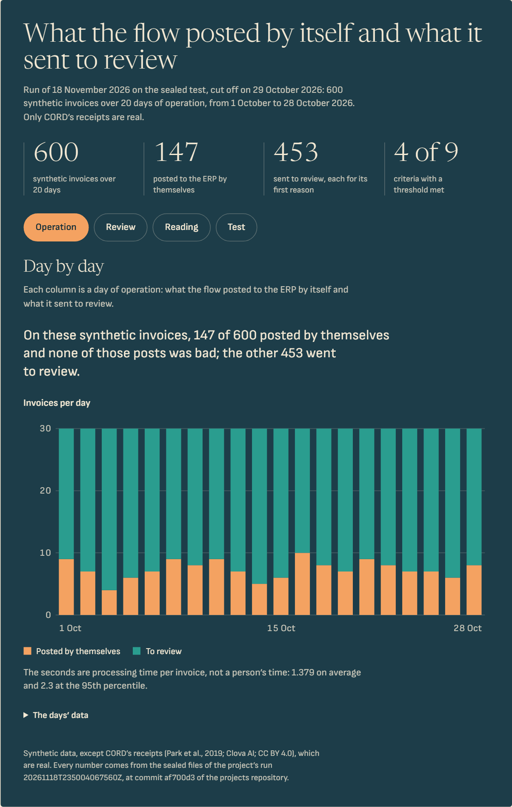
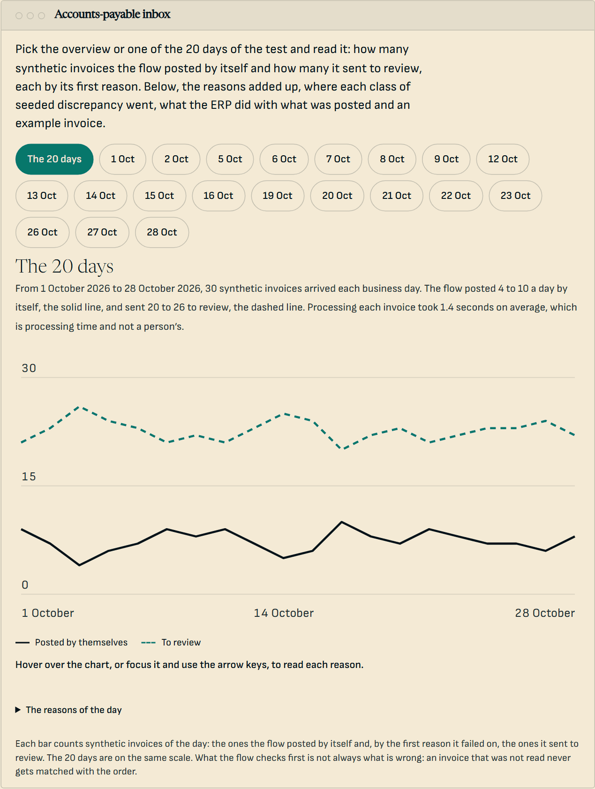
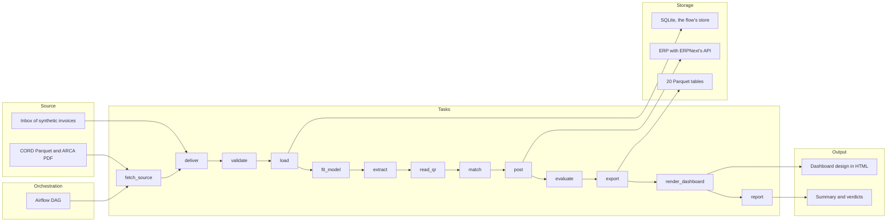

# Can invoice entry into the ERP be automated with Donut, QR and three-way matching?

**English** · [Español](README.es.md)

Automatic posting of supplier invoices into the ERP, with a three-way match.



|  |  |
| --- | --- |
| **Result** | 4 of 9 success criteria met |
| **Tech stack** | Python, PyTorch, Transformers, pyzbar, OpenCV, FastAPI, SQLite, Parquet, Apache Airflow, Docker |
| **Techniques** | Document understanding (Donut), Fine-tuning, Reading ARCA’s QR, Three-way match, Wilson intervals and paired resampling |
| **To audit** (in Spanish) | [Model card](docs/model-card.md) · [Independent evaluation](docs/evaluation.md) · [Evaluation results](reports/evaluation_summary.md) · [Decision log](docs/decisions.md) |

## 1. Executive summary

### 1.1 Business problem and solution

**Business problem and target audience.** Built for the accounts-payable teams of B2B companies, who receive their suppliers’ invoices as PDFs or images and key them into the ERP one by one, matching them by hand with the purchase order and the receiving note. It is slow and it errs exactly where it costs: a price above the order’s, more quantity than was received or an invoice posted twice.

**Proposed solution.** A daily flow that reads each invoice with a document model (Donut), anchors its header on ARCA’s QR, matches it three ways with the purchase order and the receiving note, and posts it as a draft into the ERP only when it adds up. Each invoice takes one of three paths:

- **Automatic posting:** the draft is created in the ERP and read back, field by field.
- **Review with its reason:** it goes to accounts payable with the first of 18 possible reasons, from a QR that was not read to a quantity above what was received.
- **Quarantine:** a file that is not a one-page invoice is not read, and its invoice goes to review.

### 1.2 Success criteria and impact

**Criteria set before measuring.** Before building, nine criteria with a threshold and one informational were written down, with what was expected of each: among them, that the fit loses no more than 2 TED points on the real CORD receipts, that 90 % of the lines of a known layout and 80 % of those of a new layout are read exactly, that the QR is read in 97 %, that bad loads stay at or under 2 % and that 85 % of the clean invoices of known suppliers post by themselves. The synthetic test was generated after the model was sealed and evaluated only once.

**Impact and main result.** On the 600 synthetic invoices of the test, the flow posted 147 by itself without posting any wrong and sent the 167 seeded discrepancies to review; comparing only the QR, the B1 baseline would have loaded 46 wrong. But 4 of the 9 criteria with a threshold are met: a new layout is read in 0 % of its lines, 69.7 % of the clean invoices of known suppliers post by themselves and the QR is read in 83.1 %.



## 2. Datasets and preparation

### 2.1 Sources, scope and granularity

- CORD: A Consolidated Receipt Dataset for Post-OCR Parsing. Clova AI, on GitHub; Park et al. (2019). https://github.com/clovaai/cord (CC BY 4.0)

| Attribute | Specification |
| --- | --- |
| Volume (M × N) | 2,900 synthetic invoices × 20 fields of the invoice task, plus 1,000 real CORD receipts |
| CORD splits | 800 training receipts, 100 for validation and 100 for the test, which is opened only once, at the close |
| Synthetic splits | 2,000 training invoices, 200 and 100 for validation (known and new suppliers) and 600 for the test, 300 per cohort |
| Suppliers and layouts | 40 known suppliers with layouts L1, L2 and L3; 8 new ones with L4 to validate and 15 with L5 for the test |
| Formats and scans | 40 % PDF, 30 % PNG and 30 % JPEG; 40 % scanned clean, 40 % mild and 20 % poor |
| Granularity | One row per test invoice: 600 invoices over 20 business days of 30, with 167 seeded discrepancies of 13 classes |
| Synthetic master data | 63 suppliers, one buyer, 150 items, 4,402 purchase orders and 6,176 receiving notes |
| CORD copy | Six Parquet files, 2,307,284,272 bytes, each with its size and SHA-256 fingerprint checked |

<details>
<summary>Fields available in the dataset (20)</summary>

| Column | Content | Unit | Data type |
| --- | --- | --- | --- |
| `header.tipo` | Voucher type | — | Integer |
| `header.pto_vta` | Point of sale | — | Integer |
| `header.nro` | Voucher number | — | Integer |
| `header.fecha` | Issue date | — | Date |
| `header.cuit_emisor` | Issuer’s CUIT | — | CUIT (text) |
| `header.razon_social` | Issuer’s company name | — | Text |
| `header.cuit_receptor` | Recipient’s CUIT | — | CUIT (text) |
| `header.orden_compra` | Purchase order cited | — | Text |
| `header.moneda` | Currency | — | Text |
| `header.cae` | Authorization code (CAE) | — | Text |
| `line.code` | Item code | — | Text |
| `line.desc` | Item description | — | Text |
| `line.qty` | Quantity | the line’s unit | Decimal |
| `line.unit` | Unit of measure | — | Text |
| `line.unit_price` | Unit price | the invoice’s currency | Decimal |
| `line.amount` | Line amount | the invoice’s currency | Decimal |
| `totals.neto` | Net taxable amount | the invoice’s currency | Decimal |
| `totals.iva_21` | VAT at 21 % | the invoice’s currency | Decimal |
| `totals.iva_105` | VAT at 10.5 % | the invoice’s currency | Decimal |
| `totals.total` | Total | the invoice’s currency | Decimal |

</details>

Of CORD the flow uses only the line items (menu), the subtotal and the total of each receipt. CORD carries no supplier, CUIT, date, point of sale, number or currency: those fields come from the synthetic invoices and their QR, of 13 fields.

### 2.2 Cleaning and quality rules

- **Untrusted inputs.** A file in the inbox is accepted only if it is a PNG, a JPEG or a one-page PDF holding one image, within the caps on bytes, pixels and objects; anything else is quarantined and its invoice goes to review as a rejected file. In the run, all 22 deliveries loaded without a rejection.
- **Pinned sources.** The six CORD Parquet files and ARCA’s QR specification are accepted only with their pinned size and SHA-256 fingerprint; the flow downloads nothing.
- **Strict reading of CORD.** Of the 900 training and validation receipts, the line items come as a list in 508 and as a single object in 392: they are always read as a list. Of their totals, 865 can be read, 12 cannot and 23 are missing, and they are left as they are, uncorrected.
- **Normalization without guessing.** What the model reads becomes decimal amounts, dates, CUITs and quantities only if it has the printed form; a required field that cannot be normalized stays empty and the invoice goes to review as an incomplete reading, never filled in by inference.
- **Labelled synthetic data.** Every CUIT is in the range 30-0000xxxx-d, the one in the example of ARCA’s specification; every page says “DOCUMENTO SINTÉTICO — SIN VALIDEZ FISCAL” (synthetic document, no fiscal validity), and the synthetic truth lives apart: no task of the flow reads it, only the evaluation and the baselines.

## 3. Architecture and methodology

The flow runs thirteen tasks in a fixed order, the same from the command line and from Apache Airflow’s invoiceflow_daily DAG in Docker: fetch_source → deliver → validate → load → fit_model → extract → read_qr → match → post → evaluate → export → render_dashboard → report. Since there is no source system, the operation is simulated: a launch that fits and seals the model, 20 daily deliveries of 30 synthetic invoices and a close that evaluates the test only once.

### 3.1 Source and ingestion

- **Pinned sources (fetch_source).** It downloads nothing: it checks that the six CORD Parquet files and the PDF of ARCA’s QR specification are in place, with their pinned size and SHA-256 fingerprint. A different or missing file rejects the run without writing anything.
- **The day’s delivery (deliver).** Since there is no source system, the 600 synthetic test invoices arrive in 20 daily deliveries of 30, 15 from known suppliers and 15 from new ones, with their orders and receiving notes loaded into the ERP on their date. With no delivery pending, the run ends there.
- **Quality gate (validate).** It applies 13 rules on the source, the delivery, each file and the model: the blocking ones reject the delivery if they fail, the warning ones set the file aside, into quarantine with its invoice to review, or warn, and the informational ones only report.

### 3.2 Orchestration and transformation

- **Flow control (Apache Airflow).** The invoiceflow_daily DAG runs the thirteen tasks on business days, with one run and one task active at a time because the store is a SQLite file with a single writer. A rejection by the validation or the source fails the task with no retry, since it would fail the same way; any other error keeps the task’s retries.
- **One writer and the state of each run.** Each task takes the data folder’s write lock while it runs and records its result, its seconds and its memory peak in the run’s state; another run that finds the lock taken is refused without writing. The same tuple of tasks runs from the command line, from the entry API and from Airflow.
- **Reading, matching and posting (extract, read_qr, match, post).** Donut reads each page and returns its fields already in order; the QR is read with pyzbar and, when it returns nothing, with OpenCV Aruco; the match compares the supplier, the lines, the prices and the quantities with the purchase order and with what the receiving notes received, and post creates one draft per invoice, idempotent by supplier and number, and reads it back.



### 3.3 Storage and data modelling

- **The flow’s and the ERP’s store (SQLite).** The invoices stay as files. The flow keeps in a SQLite file what was validated, read, decided and posted, with the tables of what was issued insert-only and the amounts as decimal text; the ERP stand-in has its own SQLite file.
- **Star-schema analytical layer (Parquet).** The export task writes 20 Parquet tables, with unique keys and referential integrity checked. The invoice fact holds only the evaluated test, and the dashboard design’s measures read only what was sealed.
- **The test’s seal.** The launch saves the model as safetensors with its SHA-256 fingerprint, never as pickle, and writes a seal with the fingerprint of every configuration key that changes a sealed value: an evaluation under another configuration is refused before it writes.

<details>
<summary>Data model (20 tables)</summary>

| Table | Kind | Columns | Joins |
| --- | --- | --- | --- |
| `Date` | dimension | 4 | — |
| `Supplier` | dimension | 5 | — |
| `Reason` | dimension | 4 | — |
| `Field` | dimension | 3 | — |
| `Cohort` | dimension | 2 | — |
| `Scan profile` | dimension | 2 | — |
| `Seeded class` | dimension | 3 | — |
| `Baseline` | dimension | 2 | — |
| `Model` | dimension | 6 | — |
| `Run` | dimension | 13 | — |
| `Invoices` | fact | 20 | Date (`date_key`); Supplier (`supplier_key`); Reason (`first_reason_key`); Cohort (`cohort_key`); Scan profile (`scan_key`); Seeded class (`planted_key`) |
| `Reasons per invoice` | fact | 3 | Reason (`reason_key`) |
| `Reading per field` | fact | 7 | Field (`field_key`); Cohort (`cohort_key`); Scan profile (`scan_key`) |
| `QR reading` | fact | 7 | Cohort (`cohort_key`); Scan profile (`scan_key`) |
| `Daily operation` | fact | 9 | Date (`date_key`) |
| `Baselines` | fact | 10 | Cohort (`cohort_key`); Baseline (`baseline_key`) |
| `CORD test` | fact | 9 | Model (`model_key`) |
| `Epoch choice` | fact | 7 | — |
| `Criteria` | fact | 15 | — |
| `Validation rules` | fact | 8 | Run (`run_key`) |

</details>

### 3.4 Experimentation and machine learning

- **Rigour and traceability protocol.** Every technical decision went into the decision log with its context, its options, the decision, the reason and its status. The criteria and what was expected of each were written down before building; the tolerances of the match and of the epoch choice live in the configuration, and the intervals use Wilson for a proportion and 2,000 paired resamples with seed 0 for a difference. The synthetic test is generated after the model is sealed and evaluated only once.

#### 3.4.1 Feature engineering and baseline

Donut reads the image of the whole page, with no separate text-recognition step, and returns a tree of 20 fields: ten in the header, six per line and four in the totals. It is fitted from the CORD checkpoint with two tasks, the receipts’ and the invoices’, with the 800 training receipts and the 2,000 synthetic invoices in every epoch. The baseline it has to beat is the unadjusted checkpoint itself, which posted none of the 600 test invoices by itself; the others compare with sending everything to review, with looking only at the QR and with deciding on the true fields.

**Baselines: what is the flow measured against?** (D18)

- **Selected alternative:** Four baselines on the same invoices and with the same decision: B0 sends everything to review, B1 compares only the QR with what is printed, two ways, B2 uses the unadjusted checkpoint with the rules and B3 decides on the true fields. B0 tells what not automating costs; B1, what reading the lines and the receiving notes adds; B2, what the fit adds, and B3 tells the reading errors from the rule’s.
- **Rejected alternatives:** No baselines: Zero bad loads would say nothing without knowing how many a simpler flow would load wrong: B1 loaded 46 of the 600 test invoices wrong.

#### 3.4.2 Modelling decisions and ablation (ADR)

<details>
<summary>5 decisions, each with what was rejected</summary>

**The document model** (D09)

- **Selected alternative:** Donut fitted from its CORD checkpoint, with two tasks and going over the 800 CORD receipts in every epoch. It reads the image and returns the fields in order without a separate text recognition; starting from the CORD checkpoint is the shortest way to reading invoices without forgetting the receipts, and a criterion measures whether it forgets them.
- **Rejected alternatives:** The checkpoint unchanged: Unadjusted it does not read an invoice: it posted none of the 600 of the test by itself.
- **Rejected alternatives:** Fitting from base Donut, without CORD: It starts the receipts from scratch, needs another download and more epochs, and its CORD figure could not be compared with the checkpoint’s.
- **Rejected alternatives:** docTR for the text and rules for the fields: Not measured: docTR was not installed, and the rule for the fields would be one more model to maintain.

**Choosing the epoch** (D12)

- **Selected alternative:** Among the candidate epochs 2, 4 and 6, those that lose no more than 2.0 TED points against the checkpoint on the CORD validation, and of those the one that best reads the lines of the two synthetic validations. The tolerance is relative to the checkpoint itself, so it does not depend on whether the CORD validation is easier. With the checkpoint at 94.00, the floor was 92.00: epoch 2 came in at 87.98, epoch 6 at 91.98, 0.02 below the floor, and epoch 4 was chosen, at 92.78.
- **Rejected alternatives:** The last epoch: It does not measure what matters: epoch 6 lost more TED than tolerated.
- **Rejected alternatives:** The one with the lowest validation loss: The loss is not the exactness of a line.

**Where the issuer’s fields come from** (D06)

- **Selected alternative:** The QR rules the fields it carries; the model also reads what is printed and they are compared; the company name comes from the ERP’s master data by the CUIT, and without a QR read and valid the invoice goes to review. The QR is the fiscal reference for those fields and does not depend on reading the image well; comparing it with what is printed catches a tampered QR and a model error in the header.
- **Rejected alternatives:** Everything from the model: It puts the header in the hands of what generalizes worst to a new layout.
- **Rejected alternatives:** Everything from the QR, and the model only for the lines: It would not see a QR that does not match what is printed.

**How to decide whether an invoice is posted** (D15)

- **Selected alternative:** 18 reasons in a fixed order, two-way and three-way, with the tolerances in the configuration: 2 % of the unit price, no quantity above what was received and 0.01 of rounding per line. It gives one reason per invoice that accounts payable understands, it is audited rule by rule, and the B3 oracle tests the rule against what the generator meant to seed.
- **Rejected alternatives:** A classifier trained on the synthetic invoices: It would learn the generator, not accounts payable.
- **Rejected alternatives:** A language model that retrieves the order (RAG): It adds a component that can make things up and cannot be audited rule by rule.

**Which ERP it posts into** (D16)

- **Selected alternative:** A local stand-in (FastAPI and SQLite) with the shape of ERPNext’s REST API, and a smoke test against real ERPNext v15 in Docker, once. The tests stay fast and the posting is real: create, look up, read back and never duplicate; the smoke test checks that the client talks to a real ERPNext.
- **Rejected alternatives:** Real ERPNext for everything: It would make every integration test take minutes.
- **Rejected alternatives:** Odoo Community: According to its documentation, its external API is tied to Odoo.com’s plans, and it was not verified on a self-hosted install.

</details>

#### 3.4.3 Validation protocol (sealed test)

There is no time series to validate backwards: the model is validated with separate splits and a sealed test that is read only once. The epoch is chosen on three validations, CORD’s and two synthetic ones, one of known suppliers and one of a new layout, L4. The synthetic test, 300 invoices of known suppliers and 300 of a layout the fit never saw, L5, is generated after the seal and evaluated once at the close, as are the 100 CORD test receipts. Every proportion carries its 95 % Wilson interval and every difference a paired resampling by invoice, or by receipt on CORD.

### 3.5 Consumption and governance

- **Consumption interfaces.** The Parquet tables and the dashboard design in HTML, with five pages and the relationships, are delivered with the project; the dashboard shown at the top is drawn from the run’s sealed files. The entry API, only on the local machine or Docker’s internal network and with a token, runs a delivery on request.
- **Governance artefacts.** The report task closes the run with the summary of the verdicts. The model card states its intended and unintended use, its data, its limits and its times; the decision log keeps every choice, and the runbook says what to do when something does not go as expected.
- **Full lineage.** Every published figure carries the run that wrote it, the model’s fingerprint and the sealed configuration’s. The export for the site is five JSON files with a manifest of each one’s size and fingerprint, and every published CUIT is in the synthetic range.
- **Independent evaluation.** An evaluation made outside the build reproduced the verdicts, the 600 decisions and the seal, and found four blockers. They were fixed or stated, and whatever would have changed a sealed figure is published beside it, as a post-seal analysis.

## 4. Final product

### 4.1 Operational deliverables

- **Automation.** Every business day a flow in Airflow takes the invoices that arrived, checks them against 13 rules, reads them, matches them and posts the ones that add up into an ERP through the ERPNext API, a local stand-in that was also tested once against real ERPNext v15. Since the test set is historical, the flow splits it into 22 deliveries: the launch, 20 daily ones and the close, and all 22 loaded without a rejection. Each daily run takes 49 to 60 seconds on the development machine, against a limit of 120, and the close took 1,032 seconds against the 10 minutes that were asked: it was not met. The email entry is not built: it stays as future work. It is built for Airflow, where it was tested in Docker.
- **Accounts-payable inbox.** It is the inbox in the executive summary: the 20 days of the test, one at a time, with the synthetic invoices the flow posted by itself, 4 to 10 of the 30 that arrive each day, and the ones it sent to review by their first reason, the reasons added up, what the ERP did with the 147 loads and an example invoice.
- **Dashboard.** Invoices processed, posted by themselves and sent to review by reason, and seconds of processing per invoice, day by day (synthetic), in the dashboard shown at the top, drawn from the run’s real numbers. The tables are delivered, 20 in Parquet, and the dashboard’s design in HTML.

### 4.2 Reading the current results

A snapshot of the real run of 18 November 2026, on the synthetic test invoices (simulated days from 1 October 2026 to 28 October 2026):

- **Operation.** 20 business days and 600 invoices: 147 posted by themselves and 453 sent to review.
- **Why they went to review.** An incomplete reading is the first reason of 260 reviews and a QR that was not read, of 113: most are about not reading the invoice, not about a discrepancy.
- **The ERP.** 147 drafts created, 147 read back equal to what was decided and 0 failed loads.
- **Times.** 1.379 s on average per invoice; a day’s 95th percentile reached 2.300 s at most.

## 5. Conclusion

### 5.1 Evaluation against the success criteria

**Status:** 4 of 9 success criteria met.

**Not met:**

- C01 · The fit forgets some of the real CORD receipts: on its 100 test receipts, the chosen model has a TED of 85.4 and the unadjusted checkpoint, 89.6; the difference runs from −6.56 to −2.00, and the lower bound had to stay above −2.0. It was expected to be met.
- C03 · A new layout is read in 0 % of its lines, against a threshold of 80 %, and that was expected: the codes, the descriptions, the company name and the net amount are read, and the unit prices, 0.8 %, and the line amounts, 13.1 %, almost never are.
- C04 · The QR is read in 83.1 % of the invoices printed with an intact QR, against 97 %.
- C05 · No bad load in 147, but the upper Wilson bound is 2.5 % and the maximum was 2 %: at least 189 loads were needed.
- C06 · 69.7 % of the clean invoices of known suppliers post by themselves, 147 of 211, against 85 %.

The verdict against the nine criteria with a threshold set before building, measured only once on the sealed test. Every figure is synthetic, except CORD’s:

- **C02 · Lines of a known layout.** 95.9 % of the lines of the invoices of known suppliers were read exactly (95 % interval, 94.6 to 96.8), above a threshold of 90 %: it is met.
- **C07 · Review of what does not add up.** The 167 invoices with a seeded discrepancy went to review, 100 % against the 99 % asked: it is met.
- **C08 · The three-way match prevents bad loads.** By invoice, as sealed, B1 loaded 46 of the 600 wrong and the flow none: a difference of 7.7 points (95 % interval, 5.7 to 10.0), above zero, and it is met. By load, as the preregistration sets it and calculated after the seal, the difference is 23.4 points, from 17.5 to 29.8.
- **C09 · What was posted is what was decided.** 147 of 147 loads were read back from the ERP equal to what was decided, and repeating the last day created no new invoice: it is met.

**Bad loads of the flow and its baselines, on the 600 synthetic test invoices**

| Baseline | Bad loads | What it measures |
| --- | --- | --- |
| The flow (three-way match) | 0 of 147 loads | The system in use: fitted reading, QR and the match with the order and the receiving note |
| B1, only the QR two ways | 46 of 197 loads (23.4 %) | What reading the lines and the receiving notes adds |
| B2, the unadjusted checkpoint | No load: all 600 to review | What the fit adds |
| B0, everything to review | No load: all 600 to review | What not automating costs |

### 5.2 Methodological limits

Everything measured comes from invoices that the project’s own generator draws, in five layouts: there is not a single real invoice, so the result measures the flow and does not promise how much it would post of a company’s invoices. The fit does not generalize to a layout it never saw, the flow posts a single voucher type, the A invoice, and CORD, Indonesian and made of receipts, serves to measure whether the fit forgets, not to measure the reading of an Argentine invoice; since the checkpoint had already been measured on the CORD test during the research, that figure is not an independent measure of the fit. The run’s ERP is a local stand-in: against real ERPNext v15 a smoke test ran, once, and the sealed close took 1,032 s against the 10 minutes asked.

### 5.3 Future work

- **New layouts.** Fit with more layouts and fonts, or with real invoices from a company’s suppliers, and measure the reading again on a layout the fit never saw.
- **A test large enough for 2 %.** With at least 189 automatic loads, zero bad loads would show fewer than 2 %; with 147 it is not enough.
- **The small QR.** Measure with a higher scan resolution: at 2.5 and 3 cm with a poor scan no reader read it, and at 4 cm it was read in every profile.
- **A close within 10 minutes.** With the corrected code, which reads the checkpoint’s pages eight at a time, the close of a rebuild on a copy of the data took 411 s; the sealed run keeps its 1,032 s.
- **The email entry and a real ERP.** The email trigger and the notice to accounts payable were not built, and posting into a real ERPNext needs a field with the master data’s order numbers, which was not tested.

## Run it

Python 3.11, on PowerShell, from the repository folder:

```powershell
py -3.11 -m venv .venv
.venv\Scripts\python -m pip install torch==2.14.1 --no-deps --index-url https://download.pytorch.org/whl/cu130
.venv\Scripts\python -m pip install -r requirements-dev.txt
.venv\Scripts\python -m pip check
$env:PYTHONPATH = "src"

# The sources: CORD pinned to its commit and the ARCA specification, size and SHA-256 checked
.venv\Scripts\python research\s00_download.py
.venv\Scripts\python research\s08_arca_docs.py

# Tests, without the ones that need CORD, the GPU, Docker or ERPNext
.venv\Scripts\python -m pytest

# Quick run with a tiny CORD and a tiny model; everything stays in data\quick\, which is not versioned
.venv\Scripts\python -m invoiceflow make-fixture data\quick
.venv\Scripts\python -m invoiceflow replay --config config\pipeline.quick.toml

# Real run, with the sources in place and a GPU; the fine-tuning takes over an hour
.venv\Scripts\python -m invoiceflow replay
.venv\Scripts\python -m pytest -m real_data

# Airflow in Docker
.venv\Scripts\python -m pytest -m docker

# Documentation figures and the results block of README.es.md
.venv\Scripts\python -m invoiceflow figures
.venv\Scripts\python -m invoiceflow docs-sync
```

Every operation, with its failures and how to recover, is in the [runbook](docs/runbook.md) (in Spanish).

## Source and licence

Receipts: Park et al. (2019), «CORD: A Consolidated Receipt Dataset for Post-OCR Parsing», Clova AI, CC BY 4.0 (https://creativecommons.org/licenses/by/4.0/), commit `7f0115a4`. Copy used: the six Parquet files of the pinned commit, 2,307,284,272 bytes, each with its size and SHA-256 checked. Base model: `donut-base-finetuned-cord-v2` (MIT).

QR specification: ARCA, `QRespecificaciones.pdf`, version 1, from which the generator takes the format.

The invoices, orders, receiving notes, suppliers, names and tax numbers (CUIT) are synthetic, made by this project, and belong to no company. The raw data is not versioned. The project republishes no image or crop of CORD, because nobody verified that its receipts are anonymised.
