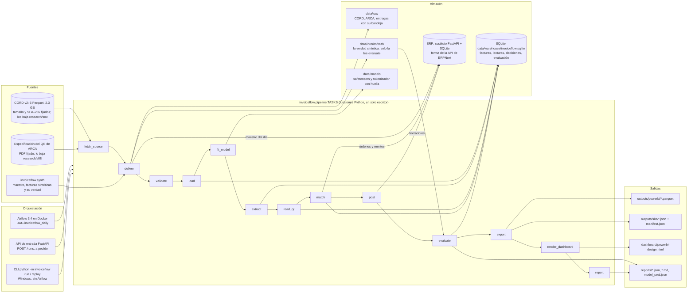

# Plan de implementación: facturas que se cargan solas al ERP

Fecha: 2026-11-18. Lee primero `requirements.md` (RF, RNF, AC y los criterios C01-C10) y `decisions.md` (D01-D43). Este plan dice cómo construirlo; si un detalle no está aquí ni allí, la decisión vuelve a quien planifica: no se adivina. Las suposiciones se marcan como **[Supuesto]** y lo que hay que comprobar antes de escribir código, como **[Verificar]**.

Convenciones: documentación en español neutro; código, identificadores, tablas y columnas en inglés; medidas DAX, títulos de visuales y textos del sitio en español. Comandos para Windows (PowerShell) y el `.venv` del proyecto; rutas relativas a `07-Ecommerce-Invoices-ERP/`. **El paquete se llama `invoiceflow`** (variables de entorno `INVOICEFLOW_*`, DAG de Airflow `invoiceflow_daily`, proyecto de Docker Compose `invoiceflow-airflow`) y **el alcance de los commits es `invoices-erp`** (el de la investigación, `a6c5774`; por ejemplo `feat(invoices-erp): …`, `test(invoices-erp): …`; D40). Cuando este plan dice «como el proyecto 06», el código de referencia es el de `06-Ecommerce-Promotion-Lift/` en su último commit corregido (`38a6c56`, con la documentación de `97f61cd`), que se adapta y se copia, no se importa.

**Datos sintéticos**: toda factura, orden, remito, proveedor, CUIT y CAE de este proyecto lo genera `invoiceflow.synth` y lo dice (D05). Cada cifra que sale de ellos lleva «(sintético)» en los textos y `synthetic: true` en los JSON.

## 1. Arquitectura



Principios (los de los proyectos 01 a 06, más los de sus evaluaciones):

- Cada tarea es una función `fn(ctx: RunContext) -> dict` sin dependencias del orquestador. El DAG de Airflow, la API de entrada y la CLI recorren la misma tupla `TASKS` con las mismas funciones (D26).
- **Un solo escritor**: todo comando que escribe toma `data/interim/pipeline.lock` antes de su primera escritura (D29); la API de entrada responde 409 si el bloqueo está tomado y el DAG de Airflow falla sin escribir (`RunLockedError`, sin reintentos).
- Toda salida versionada se escribe a un temporal, se sincroniza y se renombra con `os.replace`; los conjuntos de archivos llevan un manifiesto escrito al final.
- **La factura manda**: el grano de lo que se carga, se lee, se decide y se emite es la factura; los campos leídos son filas (factura × campo).
- **La verdad está aparte** (D23): `data/interim/truth/` solo la abre `truth.read_truth`, y solo la llaman `evaluation.py` y `baselines.py`; cualquier otro llamador lanza `LeakageError`.
- **La decisión es una**: `decide.decide(invoice_fields, qr, erp_view, cfg_view)` es la única que produce `auto_post` o `review`; las líneas base B1-B3 la llaman con otras entradas, no con otra regla.
- **El ERP es una interfaz**: `erp.client.ErpClient` habla la forma de la API REST de Frappe (`/api/resource/<DocType>`); el sustituto local y ERPNext real la sirven igual (D16).
- Los cálculos que terminan en un valor sellado reciben solo la **vista sellada** de la configuración (`SealedConfig`; D21). Cada cifra de validación lleva `fit_splits`.
- Toda ruta relativa se resuelve contra la carpeta del proyecto (`INVOICEFLOW_HOME`), nunca contra el directorio de trabajo.
- **Nada sale a la red durante una corrida**: ni ARCA, ni Hugging Face (`HF_HUB_OFFLINE=1` en el flujo; el checkpoint fijado ya está en el caché), ni el ERP salvo el configurado.

## 2. Estructura de carpetas

```text
07-Ecommerce-Invoices-ERP/
  README.md
  pyproject.toml              # paquete invoiceflow (src layout), pytest, marcas y la suite por defecto
  requirements.txt            # flujo y servicios sin torch (pandas, pyarrow, Pillow, qrcode, pyzbar, OpenCV, pypdf, FastAPI…)
  requirements-ml.txt         # -r requirements.txt, torch, transformers, tokenizers, sentencepiece, huggingface-hub, safetensors, zss
  requirements-dev.txt        # -r requirements-ml.txt, pytest, httpx
  requirements-research.txt   # el de la investigación (ya versionado)
  .gitignore                  # data/raw/, data/interim/, data/warehouse/, data/models/, data/erp/, data/quick/, airflow/logs/, airflow/config/, airflow/plugins/, airflow/.env, reports/validation/history/
  .dockerignore               # solo requirements*.txt, src/, sql/, config/ entran al contexto de la imagen
  config/
    pipeline.toml             # configuración completa (sección 4)
    pipeline.quick.toml       # modo rápido: extends = "pipeline.toml", todo bajo data/quick/
  sql/
    schema/001_core.sql  002_flow.sql  003_eval.sql
    marts/powerbi/
    checks/load/  checks/model/
  src/invoiceflow/
    __init__.py  __main__.py  cli.py  config.py  pipeline.py  lock.py  sysinfo.py  files.py  texts.py
    sources.py  cord.py  deliveries.py  validate.py  intake.py  warehouse.py  truth.py
    synth/__init__.py  synth/cuit.py  synth/master.py  synth/invoices.py  synth/render.py  synth/layouts.py  synth/qrpayload.py
    qr.py  normalize.py
    model/__init__.py  model/serialize.py  model/extractors.py  model/donut.py  model/train.py  model/choose.py  model/artifact.py  model/tiny.py
    match.py  decide.py  erp/__init__.py  erp/client.py  erp/standin.py
    registry.py  launch.py  daily.py  baselines.py  metrics.py  evaluation.py  reporting.py
    export.py  site_export.py  figures.py  api.py
    dashboard/__init__.py  dashboard/semantic_model.py  dashboard/render.py  dashboard/svg.py
  airflow/
    Dockerfile  docker-compose.yaml  .env.example  init.sh
    dags/invoiceflow_daily.py
  docker/
    erpnext/compose.yaml      # la pila de ERPNext v15 para la prueba de humo (marca erpnext)
  research/                   # s00-s08 de research.md y research/plan/p01-p03 (ya versionados)
  dashboard/powerbi-design.html          # generado (versionado)
  outputs/powerbi/*.parquet              # generado (versionado, ≤ 25 MB cada uno)
  outputs/site/*.json, manifest.json     # generado (versionado, ≤ 200 KB sin el manifiesto)
  reports/evaluation_summary.json|.md, reports/model_seal.json, reports/validation/latest.json|.md
  docs/  research.md requirements.md plan.md decisions.md
         data-dictionary.md model-card.md runbook.md paso-a-paso.md review-advisories.md evaluation.md figures/*.png
  tests/
    conftest.py               # accesorios de sesión, extractor de prueba y presupuesto de la suite (sección 24)
    fixtures/make_cord_fixture.py  fixtures/stub_extractor.py  fixtures/hand_cases.py
    unit/  contract/  integration/  e2e/  docs/
  data/raw/  data/interim/  data/warehouse/  data/models/  data/erp/  data/quick/   # nunca versionados
```

Entorno (U01): el `.venv` ya existe con `requirements-research.txt` (torch 2.14.1 del índice CUDA 13.0). U01 instala `requirements-dev.txt` encima y corre `pip check` (por su código de salida). torch no se pide a PyPI: el README y el runbook R1 dicen el comando del índice de PyTorch (CUDA en Windows, CPU en la imagen de Docker) y `requirements-ml.txt` fija `torch==2.14.1`, que pip encuentra ya instalado **[Verificar en U01 que `pip install -r` no intenta reemplazarlo]**. Las pruebas y los comandos usan `PYTHONPATH=src`, como los proyectos 03 a 06.

Marcas de pytest: `real_data` (CORD en `data/raw/`), `model` (el checkpoint fijado en el caché de Hugging Face), `gpu` (CUDA), `docker`, `erpnext` y `slow` (informativa). Por defecto: `-m "not real_data and not model and not gpu and not docker and not erpnext"`.

## 3. Flujo de datos

Un lanzamiento, 20 entregas diarias y un cierre componen la historia (D22); una corrida más termina como `no_delivery`. Los días de prueba son los hábiles de lunes a viernes del 2026-10-01 al 2026-10-28 (sin feriados: **[Supuesto]** la operación simulada no los modela).

| Entrega | Qué trae | `as_of` | Qué pasa además |
| --- | --- | --- | --- |
| `L2026-09-30` | `train` (2.000), `validation_known` (200) y `validation_new` (100) sintéticas; el maestro hasta el 2026-09-30; CORD `train` y `validation` | 2026-10-01 00:00 | Ajusta Donut con las dos tareas, mide las épocas candidatas en validación, elige (D12), corre el oráculo B3 en validación (M06), guarda el artefacto y sella el lanzamiento |
| `D2026-10-01` … `D2026-10-28` | 30 facturas del día (15 `test_known` y 15 `test_new`), generadas en ese momento; los movimientos del maestro del día (órdenes y remitos) | 00:00 del día siguiente | Carga los movimientos del día en el ERP, valida la bandeja, lee, decodifica, cruza, decide, carga los `auto_post` y emite todo de solo inserción |
| `C2026-10-29` | nada | 2026-10-29 00:00 | **Evalúa la prueba una vez** (C01-C10, B0-B3, la prueba de CORD) y la sella |

1. `fetch_source`: comprueba los seis Parquet de CORD y el PDF de ARCA (V01, V06); si falta el índice canónico de CORD o su huella de origen no coincide, lee `train` y `validation` (V02-V05) y escribe el índice con su manifiesto al final. **Nunca abre `test`** (D10).
2. `deliver`: publica la siguiente entrega pendiente. El lanzamiento: genera las tres particiones de ajuste y validación con su verdad y el maestro; carga en el ERP los proveedores, los artículos y los movimientos hasta `as_of`. Una diaria: **comprueba que el sello tiene la parte `launch`** (si no, `GenerationRefusedError`, salida 2), genera las facturas del día en `data/raw/deliveries/<id>/inbox/` y su verdad en `data/interim/truth/<id>.jsonl`, y carga en el ERP los movimientos del día. Sin pendientes: `no_delivery`.
3. `validate`: reglas V10-V16 sobre la bandeja; los archivos que no pasan van a `data/raw/deliveries/<id>/quarantine/` con su regla. Con una regla bloqueante de la entrega: corrida `rejected`, `ValidationError`.
4. `load`: se niega sin una validación aprobada de esta corrida; en una transacción registra la entrega y una fila por archivo aceptado o en cuarentena en `invoices`; abre la fila de `pipeline_runs` como `running`.
5. `fit_model`: en el lanzamiento, el ajuste, la elección, el artefacto y la parte `launch` del sello (sección 9). En las demás, comprueba la huella del artefacto (M02) y el estado del sello (M03); no reajusta.
6. `extract`: lee cada factura aceptada con el modelo sellado y escribe `extracted_fields` (solo inserción).
7. `read_qr`: decodifica y valida el QR de cada factura y escribe `qr_reads` (solo inserción).
8. `match`: arma la vista del ERP de cada factura (orden, remitos hasta el día, lo ya facturado) y escribe `decisions` y `decision_reasons` (solo inserción) con `decide`.
9. `post`: carga cada `auto_post` en el ERP como borrador, la lee de vuelta y escribe `erp_posts` (solo inserción); un error del ERP deja la factura `post_failed` en `review_queue`.
10. `evaluate`: solo en el cierre: evalúa la prueba sintética y la de CORD y escribe la parte `test` del sello, o comprueba que reproduce la sellada.
11. `export`: reconstruye los marts de Power BI, corre `sql/checks/model/` y exporta el modelo estrella y los archivos del sitio.
12. `render_dashboard`: HTML del diseño desde la especificación y los Parquet exportados.
13. `report`: escribe `reports/evaluation_summary.*` y `reports/validation/latest.*` y cierra la corrida en el orden del proyecto 06 (SQLite `ok`, `dim_pipeline_run.parquet`, `summary.json` y el manifiesto, el HTML, la entrega `loaded`).

## 4. Configuración

`config/pipeline.toml`, leído con `tomllib`, con dataclasses congeladas y comprobación clave por clave como el proyecto 06: una sección o clave desconocida, una faltante, un tipo equivocado o un valor fuera de su dominio son `ValueError` con el nombre de la clave. **Cada clave tiene que cambiar algo o estar declarada informativa**, y una prueba lo recorre (la lección B2 del proyecto 06: una clave validada y nunca leída).

```toml
[source]                                   # D02
cord_dir = "data/raw/cord"
cord_commit = "7f0115a4b758a71d6473b8d085751692da2fef98"
max_shard_bytes = 600000000
max_rows = 1000
max_image_pixels = 16000000                # la imagen más grande de CORD: 3.024 x 4.224 = 12,8 millones
max_gt_depth = 8
arca_spec_path = "data/raw/arca/QRespecificaciones.pdf"
arca_spec_bytes = 91626
arca_spec_sha256 = "a6d0f71e14f282836f07834af76a975dd885386bf972d860878d4b44278deaac"
[[source.cord_files]]                      # uno por fragmento; los seis del manifiesto de research/s00
split = "train"
name = "train-00000-of-00004-b4aaeceff1d90ecb.parquet"
bytes = 490224630
sha256 = "da3994eee1bf9bd3c57f0d53a72c3a6812c8696c5ba26245987949ddf73483cc"
# … train-00001 (441418432, cce4def1…), train-00002 (443802181, 591e2db8…), train-00003 (455555434, 1ffd9de8…),
# validation-00000 (242080800, 0d0f6dac…), test-00000 (234202795, 51c65f17…): los valores completos de data/raw/cord/manifest.json

[calendar]                                 # D22
history_start = 2026-01-05                 # primera fecha de las facturas de ajuste y validación
launch_last_day = 2026-09-30
test_first_day = 2026-10-01
test_last_day = 2026-10-28
weekdays_only = true

[synth]                                    # D04, D05, D10
seed_master = 11
seed_train = 101
seed_validation = 202
seed_test = 303
n_train = 2000
n_validation_known = 200
n_validation_new = 100
test_per_day_known = 15
test_per_day_new = 15
suppliers_known = 40
suppliers_new_validation = 8
suppliers_new_test = 15
layouts_known = ["L1", "L2", "L3"]
layout_validation_new = "L4"
layout_test_new = "L5"
fonts_known = ["DejaVuSans", "DejaVuSansMono"]
font_validation_new = "DejaVuSansMono-Bold"
font_test_new = "DejaVuSerif"
dpi = 200
scan_profiles = { clean = 0.4, mild = 0.4, poor = 0.2 }
qr_cm = [2.5, 3.0, 4.0]
file_formats = { png = 0.3, jpeg = 0.3, pdf = 0.4 }
max_lines = 12
usd_share = 0.10
iva105_share = 0.20
planted_rate = 0.023                       # por clase; 13 clases: 0,299 de las facturas
cuit_serial_range = [1, 9999]

[qr]                                       # D06, D07
readers = ["pyzbar", "aruco"]
max_text_bytes = 1024
hosts = ["www.arca.gob.ar", "www.afip.gob.ar"]
path = "/fe/qr/"

[intake]                                   # D08
max_file_bytes = 10485760
max_pixels = 40000000
formats = ["png", "jpeg", "pdf"]
pdf_max_objects = 200

[model]                                    # D09, D11-D13
kind = "donut"                             # "tiny" solo bajo data/quick/; "stub" solo si las pruebas lo registran
base = "naver-clova-ix/donut-base-finetuned-cord-v2"
base_revision = "8003d433113256b4ce3a0f5bf604b29ff78a7451"
task_cord = "<s_cord-v2>"
task_invoice = "<s_factura_ar>"
input_size = [1280, 960]
max_length = 768
epochs = 6
candidate_epochs = [2, 4, 6]
learning_rate = 3e-5
warmup_steps = 200
batch_size = 1
grad_accumulation = 8
bf16 = true
seed = 0
cord_val_tolerance = 2.0                   # puntos de TED en la validación de CORD (M04)
infer_device = "auto"                      # cuda si hay; si no, cpu

[match]                                    # D14, D15
price_tolerance_pct = 2.0
qty_over_receipt = 0.0
rounding_per_line = 0.01
total_qr_tolerance = 0.01
supported_types = [1]
require_qr = true

[erp]                                      # D16, D17
mode = "standin"                           # "standin" o "http" (ERPNext real)
base_url = ""
token_env = "INVOICEFLOW_ERP_TOKEN"
post_as = "draft"                          # único valor aceptado; otro sale con 2 antes de escribir
timeout_s = 30

[evaluation]                               # D20
resamples = 2000
seed = 0

[criteria]                                 # preregistrados (requirements.md 8.1)
c01_min_ted_diff = -2.0
c02_min_line_exact = 0.90
c03_min_line_exact = 0.80
c04_min_qr_read = 0.97
c05_max_bad_post_upper = 0.02
c06_min_straight_through = 0.85
c07_min_review_recall = 0.99

[service]                                  # D27
host = "127.0.0.1"
port = 8000
token_env = "INVOICEFLOW_API_TOKEN"

[site]
max_total_bytes = 204800

[paths]
raw_dir = "data/raw"
interim_dir = "data/interim"
warehouse = "data/warehouse/invoiceflow.sqlite"
models_dir = "data/models"
erp_db = "data/erp/standin.sqlite"
outputs_dir = "outputs/powerbi"
site_dir = "outputs/site"
reports_dir = "reports"
seal = "reports/model_seal.json"
dashboard_html = "dashboard/powerbi-design.html"
readme = "README.md"
figures_dir = "docs/figures"
```

**Qué entra en la huella del sello** (D21). `config.py` declara `FINGERPRINT_KEYS` y `UNSEALED_KEYS`; una prueba exige que cada hoja esté en exactamente una (AC20).

- `FINGERPRINT_KEYS`: `source.cord_commit`, `source.max_image_pixels`, `source.max_gt_depth` y todas las claves de `[calendar]`, `[synth]`, `[qr]`, `[intake]`, `[model]`, `[match]`, `[evaluation]` y `[criteria]`, más `erp.post_as`. La huella agrega las huellas observadas de los seis fragmentos y del PDF, la del maestro generado y la de los archivos de fuentes tipográficas.
- `UNSEALED_KEYS`: el resto de `[source]` (rutas, tamaños y huellas aceptados, topes de bytes y filas), `[erp]` salvo `post_as`, `[service]`, `[site]` y `[paths]`.
- **Nombres**: `config_sha256` es siempre la huella de la vista sellada; la del archivo TOML se llama `config_file_sha256` y solo aparece en el estado de la corrida (A8 del proyecto 05).

`config/pipeline.quick.toml`: `extends = "pipeline.toml"`; `[source] cord_dir = "data/quick/cord"` con huellas vacías (la primera vista se registra en `data/quick/source.lock.json`, como el proyecto 06); `[synth] n_train = 24`, `n_validation_known = 8`, `n_validation_new = 4`, `test_per_day_known = 3`, `test_per_day_new = 3`, `dpi = 50`; `[calendar] test_last_day = 2026-10-05` (3 días); `[model] kind = "tiny"`, `epochs = 2`, `candidate_epochs = [1, 2]`, `input_size = [128, 96]`, `max_length = 256`, `bf16 = false`; `[evaluation] resamples = 100`; `[paths]` todas bajo `data/quick/`, incluidos el sello, el README, las figuras, el sitio y el ERP. `_check` rechaza además: huellas vacías fuera de `data/quick/`; `kind = "tiny"` fuera de `data/quick/`; `kind = "stub"` si no está registrado; una ruta relativa que sale de la carpeta del proyecto; días de prueba que no son posteriores a `launch_last_day`; `layout_test_new` o `font_test_new` que aparecen en las listas conocidas o son iguales a los de `validation_new`; `candidate_epochs` vacía, no creciente o con una época mayor que `epochs`; `price_tolerance_pct` negativa; `post_as` distinto de `draft`; `cuit_serial_range` fuera de 1-9.999.

## 5. Almacenamiento

Tres lugares, cada uno para lo suyo (D24): **archivos** para las facturas y la verdad (`data/raw/deliveries/<id>/inbox/`, `quarantine/`; `data/interim/truth/`), **SQLite** del flujo para lo relacional y **SQLite del sustituto del ERP** (`data/erp/standin.sqlite`), que solo toca `erp/standin.py`. Reglas del runner (`warehouse.py`), las del proyecto 06: autocommit con `journal_mode=DELETE`, `synchronous=FULL`, `foreign_keys=ON`; transacciones `BEGIN IMMEDIATE`; nunca `executescript()`; parámetros con nombre; deshacer ante un error.

`sql/schema/001_core.sql` (clave primaria entre paréntesis):

- `deliveries` (`delivery_id`): `kind` (`launch`, `daily`, `close`), `day`, `as_of`, `files`, `sha256`, `status` (`published`, `loaded`, `rejected`), `run_key`.
- `pipeline_runs` (`run_key`): `started_at`, `finished_at`, `status` (`running`, `ok`, `failed`, `rejected`, `no_delivery`), `delivery_id`, `as_of`, `config_sha256`, `artifact_sha256`, `invoices`, `peak_working_set_mb`, `peak_gpu_mb`, `memory_counter`, `message`.
- `validation_results` (`run_key`, `rule_id`): `name_es`, `severity`, `scope`, `aggregation` (`source`, `per_run`, `latest`), `passed`, `files_affected`, `examples_json` (claves, nunca contenidos).
- `invoices` (`invoice_key`): `delivery_id`, `file_name`, `file_sha256`, `file_format`, `bytes`, `pixels`, `status` (`accepted`, `quarantined`), `rule_id` (si cuarentena), `received_at`.

`sql/schema/002_flow.sql` (de solo inserción con los tres disparadores del proyecto 06):

- `extracted_fields` (`invoice_key`, `field`, `ordinal`): `value_raw`, `value_norm`, `model_version`, `seconds`. `field` en `header.*`, `line.code`, `line.desc`, `line.qty`, `line.unit`, `line.unit_price`, `line.amount`, `totals.*`; `ordinal` es la línea (0 en la cabecera).
- `qr_reads` (`invoice_key`): `reader` (`pyzbar`, `aruco`, nulo), `status` (`ok`, `not_read`, `invalid`), `invalid_reason`, `cuit`, `fecha`, `pto_vta`, `tipo_cmp`, `nro_cmp`, `importe`, `moneda`, `ctz`, `doc_rec_tipo`, `doc_rec_nro`, `cod_aut_tipo`, `cod_aut`, `seconds`.
- `decisions` (`invoice_key`): `decision` (`auto_post`, `review`), `first_reason`, `reasons` (cantidad), `po_number`, `supplier_cuit`, `total`, `currency`, `run_key`, `seconds_total`.
- `decision_reasons` (`invoice_key`, `reason`): `rank`, `detail_json` (claves y números, nunca texto del documento).
- `erp_posts` (`invoice_key`): `erp_name`, `status` (`posted`, `already_posted`, `post_failed`), `readback_equal`, `seconds`, `run_key`.
- `review_queue` (`invoice_key`): `reasons`, `opened_at`, `run_key` (vista de las decisiones `review` y los `post_failed`).
- `daily_ops` (`date_key`): `invoices`, `accepted`, `quarantined`, `auto_post`, `review`, `posted`, `post_failed`, `seconds_mean`, `seconds_p95`, `run_key`.

`sql/schema/003_eval.sql`: `eval_criteria` (`criterion_id`, `seal_state`), `eval_invoice` (`invoice_key`, `seal_state`: la verdad unida a lo emitido, una fila por factura de la prueba con `cohort`, `planted`, `expected_decision`, `decision`, `bad_post`, `straight_through`, `line_exact`, `lines`), `eval_field` (`cohort`, `field`, `seal_state`), `eval_baseline` (`baseline`, `cohort`, `seal_state`), `eval_cord` (`model`, `receipt_key`, `seal_state`), `eval_variants` (`variant`, `key`, `seal_state`); `seal_state` en `sealed`, `post_seal`; las filas `sealed` son de solo inserción.

**Nota del 2026-11-18 (U12, D49)**: `load` escribe además `validation_results`; `validation_results` e `invoices` son también de solo inserción; `invoice_key` es el nombre del archivo sin extensión; `review_queue` es una vista; los importes son texto decimal.

`model_registry` (`model_version`) en `002_flow.sql`: `trained_as_of`, `artifact_name`, `artifact_sha256`, `tokenizer_sha256`, `config_sha256`, `chosen_epoch`, `choice_json` (cada candidata con sus cifras de validación y `fit_splits`), `validation_digest`.

## 6. Contrato de las fuentes, las entregas y la validación

`sources.py` y `cord.py` son la única fuente de los nombres: `CORD_SCHEMA` (`image` como `struct<bytes: binary, path: string>` y `ground_truth` como `string` **[Verificar en U04 con `pq.read_schema`]**) y `CORD_SPLITS` (800, 100, 100).

| ID | Severidad | Alcance | Agregación | Regla | Acción |
| --- | --- | --- | --- | --- | --- |
| V01 | bloqueante | fuente | source | Cada fragmento de CORD existe con su tamaño y su huella (o la registrada, en modo rápido) | Rechazo sin escribir; runbook R1 |
| V02 | bloqueante | fuente | source | Esquema exacto de `CORD_SCHEMA` | Rechazo |
| V03 | bloqueante | fuente | source | Fragmento ≤ `max_shard_bytes`, filas ≤ `max_rows`, imagen ≤ `max_image_pixels` (leída la cabecera antes de decodificar) | Rechazo |
| V04 | bloqueante | fuente | source | `ground_truth` es JSON con `gt_parse` y `meta`, profundidad ≤ `max_gt_depth` | Rechazo |
| V05 | bloqueante | fuente | source | 800, 100 y 100 recibos; `meta.split` coherente (`valid` = `validation`) | Rechazo |
| V06 | bloqueante | fuente | source | El PDF de ARCA con su tamaño y su huella; el ejemplo de la especificación se reproduce con `synth.qrpayload` byte a byte | Rechazo; runbook R1 |
| V10 | bloqueante | entrega | per_run | La entrega es la siguiente del plan | Rechazo |
| V11 | bloqueante | entrega | per_run | Archivos, cantidad y SHA-256 son los del manifiesto de la entrega; la verdad del día existe (sin leerla: tamaño y huella) | Rechazo |
| V12 | advertencia | archivo | per_run | El tipo por los primeros bytes (`%PDF-`, PNG, JPEG) es uno de `formats` y coincide con la extensión | Cuarentena; `file_rejected` |
| V13 | advertencia | archivo | per_run | Archivo de 1 byte a `max_file_bytes` | Cuarentena |
| V14 | advertencia | archivo | per_run | Píxeles ≤ `max_pixels` (cabecera leída antes de decodificar; `Image.MAX_IMAGE_PIXELS` fijado) | Cuarentena |
| V15 | advertencia | archivo | per_run | PDF de una página, con una sola imagen y sin texto, JavaScript ni adjuntos; ≤ `pdf_max_objects` objetos | Cuarentena; `unsupported_pdf` en el detalle |
| V16 | advertencia | archivo | per_run | Hash repetido dentro de la entrega o con uno ya cargado | Se procesa igual: el duplicado fiscal lo decide la regla `duplicate` |
| I01 | informativa | entrega | per_run | Archivos por formato | Solo cuenta |
| I02 | informativa | modelo | per_run | Facturas leídas, decididas y cargadas | Solo cuenta |
| M01 | bloqueante | modelo | per_run | Ninguna tarea del flujo abre la verdad | `LeakageError` (D23) |
| M02 | bloqueante | modelo | per_run | El artefacto y el tokenizador tienen la huella registrada antes de leerlos; solo `safetensors` | Falla la tarea (D13; R6) |
| M03 | advertencia | modelo | latest | La configuración es distinta de la sellada | Todo es `post_seal`; la evaluación sin sello de prueba se rechaza (D21) |
| M04 | bloqueante | modelo | latest | Ninguna candidata pierde menos de `cord_val_tolerance` puntos de TED en la validación de CORD | `ModelChoiceError`: el lanzamiento se detiene (R5) |
| M05 | bloqueante | modelo | latest | Tamaños de las particiones como en la configuración; cada objetivo ≤ `max_length` fichas | `BlockSizeError` que nombra la factura |
| M06 | bloqueante | modelo | latest | El oráculo B3 sobre la validación manda a revisión el 100 % de las sembradas y carga el 100 % de las limpias con QR intacto | Detiene el lanzamiento: la regla no es la que el generador sembró (R5) |
| M07 | bloqueante | modelo | per_run | Todo CUIT que se escribe en el ERP o en una salida está en el rango sintético | Falla la tarea (D05) |

Entregas (`deliveries.py`): el plan sale de la configuración (el lanzamiento, una entrega por día hábil y el cierre). Identificadores `L<launch_last_day>`, `D<día>`, `C<día siguiente a test_last_day>`. Manifiesto `data/raw/deliveries/manifest.json` con versión, escrito a un temporal y renombrado.

## 7. El generador sintético (`synth/`)

### 7.1 Maestro (`synth/cuit.py`, `synth/master.py`)

```python
def check_digit(first10: str) -> int                         # módulo 11 de AFIP; 10 = sin CUIT
def synthetic_cuit(serial: int) -> str | None                # "300000" + serial de 4 dígitos + dígito; None si no hay
def is_synthetic_cuit(cuit: str) -> bool                     # ^300000\d{5}$ y dígito válido
@dataclass(frozen=True)
class Master: suppliers; items; buyer; events                # events: (fecha, tipo po|receipt, documento)
def master(view: SealedConfig) -> Master
```

- **CUIT** (D05): las series se sortean sin reponer de `cuit_serial_range` (9.089 válidas, `p02`), una por proveedor y una por el comprador; `synthetic_cuit` nunca devuelve un CUIT fuera de `30-0000xxxx-d` y `is_synthetic_cuit` es la guarda que usan M07 y la prueba de lo publicado. El ejemplo de ARCA (`30000000007`) está en el rango.
- **Proveedores**: 40 conocidos (diseños L1-L3, fuentes de `fonts_known`), 8 nuevos de validación (L4) y 15 nuevos de prueba (L5); nombres de una lista fija con «(ficticio)» o «(ficticia)»; condición frente al IVA «Responsable Inscripto»; de 1 a 3 puntos de venta.
- **Artículos**: unos 150 de una lista fija en español (insumos industriales, de oficina y de limpieza), con unidad y precio de lista en pesos.
- **Órdenes y remitos**: cada proveedor tiene órdenes desde `history_start`; un remito recibe toda la orden o una parte (60 % completas, 40 % en dos remitos) entre 1 y 10 días después. Los eventos se cargan en el ERP el día de su fecha (D22).

### 7.2 Facturas y su dibujo (`synth/invoices.py`, `synth/render.py`, `synth/layouts.py`, `synth/qrpayload.py`)

```python
@dataclass(frozen=True)
class InvoiceTruth: invoice_key; split; cohort; supplier_key; header; lines; totals; qr_text; qr_cm; scan_profile; file_format; planted; expected_decision; expected_reasons
def invoices(view, master, split: str, day: date | None, *, seal_path: Path) -> list[InvoiceTruth]   # GenerationRefusedError para test_* sin sello
def render(truth: InvoiceTruth, view) -> bytes                                                   # el archivo: PNG, JPEG o PDF de una imagen
def qr_text(payload: dict) -> str                                                                # https://www.arca.gob.ar/fe/qr/?p=<Base64 del JSON compacto>
```

- **Contenido**: Factura A (código 01), punto de venta de 5 dígitos, número de 8, fecha, emisor (razón social, CUIT, condición), receptor (el comprador, tipo 80 y su CUIT), «Orden de compra: OC-…», de 1 a `max_lines` líneas (código, descripción, cantidad, unidad, precio unitario, importe), neto gravado, IVA 21 % (o 10,5 % en `iva105_share`), total, moneda (`PES` o `DOL` con cotización), CAE ficticio de 14 dígitos y su vencimiento, y el QR abajo a la izquierda. Números con coma decimal y punto de miles. **La leyenda «DOCUMENTO SINTÉTICO — SIN VALIDEZ FISCAL» va en cada página**.
- **Diseños**: L1 (recuadro con la letra al centro, tabla con grilla; el del prototipo `p02` «A»), L2 (sin grilla, cantidad primero; el «B»), L3 (dos columnas de cabecera y totales en un recuadro), L4 (encabezado a la derecha y tabla con fondo alternado; solo `validation_new`) y L5 (cabecera apilada, columnas en otro orden y totales en línea; solo `test_new`). Las fuentes son las DejaVu y STIX que trae matplotlib (`matplotlib.get_data_path()/fonts/ttf`), iguales en Windows y en la imagen de Linux, con su SHA-256 en la huella **[Verificar en U06 los nombres de archivo]**.
- **Escaneo**: la página A4 se dibuja a `dpi` (200: 1.654 × 2.339 px) y se degrada según el perfil: `clean` (sin cambios), `mild` (JPEG de calidad 60 a 85, rotación de hasta 1°, ruido gaussiano leve), `poor` (desenfoque de radio 0,6 a 1,0, JPEG de calidad 35 a 50, rotación de hasta 2,5°, ruido de sal 0,5 %). El QR se imprime con el tamaño sorteado de `qr_cm` (`p02`: el tamaño y la resolución deciden; por eso entran en la verdad y C10 los informa).
- **Formato**: PNG, JPEG o PDF de una página con la imagen incrustada (Pillow), según `file_formats`.
- **Verdad**: una línea JSON por factura en `truth.jsonl`, con los campos de `InvoiceTruth`. **El texto del QR se calcula una vez** (`qr_text`) y se usa para dibujar y para la verdad.
- **Determinismo**: `random.Random` y `numpy.random.default_rng` con semillas derivadas de (`seed_*`, partición, día, índice); la misma configuración da los mismos bytes en el mismo equipo. Una prueba compara los SHA-256 de dos generaciones.

### 7.3 Discrepancias sembradas

Cada factura tiene a lo sumo una clase, sorteada con `planted_rate` por clase (las 13 suman el 29,9 %), en todas las particiones (el modelo aprende a leer también lo que está mal). La decisión esperada sale de esta tabla, **no** de las reglas: así el oráculo B3 comprueba las reglas contra la intención del generador (M06).

| Clase | Qué se siembra | Motivo esperado (primero) |
| --- | --- | --- |
| `price_off` | El precio unitario de una línea de +3 % a +10 % sobre la orden | `price_out_of_tolerance` |
| `over_receipt` | Se factura lo pedido y el remito hasta el día recibió menos | `qty_over_receipt` |
| `over_order` | Una cantidad mayor que la pedida | `qty_over_receipt` (y `qty_over_order`) |
| `total_mismatch` | El neto impreso no es la suma de las líneas (el QR trae el total impreso) | `total_arithmetic` |
| `supplier_mismatch` | La orden citada es de otro proveedor | `supplier_mismatch` |
| `no_po` | Sin número de orden, o uno que no existe | `no_po` |
| `duplicate` | El mismo comprobante (CUIT, punto de venta, tipo y número) que uno de un día anterior, escaneado de nuevo; desde el segundo día | `duplicate` |
| `date_before_po` | La fecha de la factura es anterior a la de la orden | `date_out_of_range` |
| `currency_mismatch` | Factura en `DOL` contra una orden en `PES` | `currency_mismatch` |
| `extra_line` | Una línea con un artículo que no está en la orden | `line_not_on_po` |
| `qr_missing` | Sin QR impreso | `qr_not_read` |
| `qr_tampered` | El importe del QR difiere del total impreso | `qr_print_mismatch` |
| `credit_note` | Nota de crédito A (tipo 3) | `unsupported_type` |

### 7.4 Particiones y guardas (D10)

- `train`, `validation_known` y `test_known` usan los 40 proveedores conocidos; `validation_new` los 8 de L4; `test_new` los 15 de L5. Ningún comprobante, CUIT de proveedor nuevo ni hash de imagen se comparte entre particiones (pruebas `test_partitions.py`).
- **La prueba se genera después del sello**: `invoices(..., split="test_known" | "test_new")` lee el sello y lanza `GenerationRefusedError` si no tiene `launch` con el mismo `config_sha256`. La semilla de la prueba está en la huella: cambiarla después es otra configuración (`post_seal`).
- Las fechas: `train` y las validaciones del `history_start` al `launch_last_day`; la prueba, del día de su entrega.

## 8. El QR (`synth/qrpayload.py`, `qr.py`)

```python
@dataclass(frozen=True)
class QrPayload: ver; fecha; cuit; pto_vta; tipo_cmp; nro_cmp; importe; moneda; ctz; tipo_doc_rec; nro_doc_rec; tipo_cod_aut; cod_aut
class QrInvalid(ValueError): reason: str
def parse_qr_text(text: str, view) -> QrPayload                       # o QrInvalid con el motivo
def read_qr(image: Image.Image, view, *, readers=None) -> QrRead     # pyzbar, después aruco; QrRead(reader, status, payload | None, reason)
```

- **Validación** (entrada no confiable; AC07): texto ≤ `max_text_bytes`; URL con esquema `https`, host en `hosts`, ruta `path` y un solo parámetro `p`; Base64 estricto (`base64.b64decode(validate=True)`); JSON objeto (no lista), versión `ver = 1`, exactamente los 13 campos de la especificación (`tipoDocRec` y `nroDocRec` pueden faltar juntos), cada uno con su tipo y largo (sección «Qué especifica ARCA» de research.md), `fecha` RFC 3339, `moneda` de 3 letras, `tipoCodAut` en {`A`, `E`}, `codAut` de 14 dígitos y `cuit` con dígito verificador válido. El ejemplo del PDF se lee bien y su Base64 se reproduce byte a byte (V06).
- **Lectura** (D07): pyzbar (`decode` con `symbols=[ZBarSymbol.QRCODE]`) sobre la página en gris; si no devuelve nada, `cv2.QRCodeDetectorAruco().detectAndDecodeMulti`. Si devuelven más de un texto, se toma el que valida; dos que validan y difieren: `qr_invalid` (`multiple_qr`). Los avisos de zbar por la consola (`pdf417.c`) se descartan sin afectar el resultado.
- **Qué hace la decisión con el QR** (D06): sus campos mandan sobre lo leído por el modelo en la cabecera; cualquier diferencia entre el QR y lo impreso en CUIT, punto de venta, número, fecha o total (a `total_qr_tolerance`) es `qr_print_mismatch`.

## 9. El modelo de documentos (`model/`)

### 9.1 Serialización (`model/serialize.py`)

```python
def json2token(obj, *, sort_keys=True) -> str            # la de Donut: claves en orden inverso, listas con <sep/>
def token2json(seq: str) -> dict | list                  # propia, sin el procesador; inversa de json2token en cada objetivo del accesorio
def invoice_target(truth: InvoiceTruth) -> dict          # el esquema de la tarea <s_factura_ar>
def new_special_tokens(targets) -> list[str]             # <s_k> y </s_k> de cada clave que el tokenizador no tiene
```

Esquema de la tarea de factura: `header` (`tipo`, `pto_vta`, `nro`, `fecha`, `cuit_emisor`, `razon_social`, `cuit_receptor`, `orden_compra`, `moneda`, `cae`), `lines[]` (`codigo`, `descripcion`, `cantidad`, `unidad`, `precio_unitario`, `importe`) y `totals` (`neto`, `iva_21`, `iva_105`, `total`), **con los valores tal como están impresos** (la normalización viene después, sección 9.5). M05 exige que cada objetivo quepa en `max_length` (CORD: máximo 375 fichas, `p01`; una factura de 12 líneas, unas 520 **[Supuesto; U09 lo mide con el tokenizador]**).

### 9.2 Ajuste (`model/train.py`, `model/tiny.py`)

```python
@dataclass(frozen=True)
class TrainItem: image: Callable[[], Image.Image]; target: str; task: str; source: str   # source: cord | synth
def build_train_set(cord_index, synth_train, view) -> list[TrainItem]
def fine_tune(items, processor, model, view, *, out_dir: Path, on_epoch) -> list[Path]  # una carpeta safetensors por época candidata
def tiny_model(vocab: list[str], view) -> tuple[processor, model]                         # sin descargas, para las pruebas y el modo rápido
```

- **Punto de partida** (D09): el checkpoint `base` en `base_revision`, del caché local (`HF_HUB_OFFLINE=1`); se agregan las fichas nuevas al tokenizador y se redimensiona el decodificador (`resize_token_embeddings`).
- **Datos**: en cada época, los 800 recibos de CORD `train` con `<s_cord-v2>` y las 2.000 facturas sintéticas `train` con `<s_factura_ar>`, mezclados con `seed` (D09: el repaso de CORD evita el olvido que mide C01).
- **Optimización**: AdamW con `learning_rate`, calentamiento lineal de `warmup_steps` y decaimiento lineal hasta 0; lote `batch_size` con `grad_accumulation`; bf16 con `torch.autocast` (`p03`: 0,162 s por paso y 7,43 GB); recorte del gradiente a 1,0; semillas de Python, NumPy y torch. Ninguna parada temprana: las épocas candidatas se guardan y se eligen en validación.
- **Sin CUDA** el ajuste real sale con `RunRefusedError` (salida 2, runbook R5); el modo rápido ajusta el modelo diminuto en CPU (D11).
- **El modelo diminuto** (`tiny_model`): un `VisionEncoderDecoderModel` con un codificador `DonutSwinConfig` de 2 etapas, `embed_dim` 16 y ventana 4, y un decodificador `MBartConfig` de 1 capa y `d_model` 32, con un tokenizador `WordLevel` armado en memoria con `tokenizers`. **Verificado el 2026-11-18 (U10)**: transformers 5.22.1 arma los dos sin descargar nada ni abrir un socket (decenas de miles de parámetros; D47).

### 9.3 Elección (`model/choose.py`; D12)

Para cada época candidata: TED y recuerdo de hojas en CORD `validation` (100), y tasa de líneas exactas en `validation_known` y `validation_new`. Se descartan las que tienen TED de CORD < TED del checkpoint en la misma validación − `cord_val_tolerance` (93,65 − 2,0 = 91,65 si se repite lo de `p01`; el lanzamiento vuelve a medir al checkpoint). Entre las que quedan, la de mayor media de las dos tasas sintéticas; empate a 10⁻⁶: la época más temprana. Sin ninguna: `ModelChoiceError` (M04). Cada cifra se guarda con `fit_splits = cord_train+synth_train`.

### 9.4 Artefacto (`model/artifact.py`; D13)

La época elegida se guarda con `save_pretrained(..., safe_serialization=True)` (`model.safetensors`, `config.json`, `generation_config.json`) y el tokenizador como `tokenizer.json`; se registran el SHA-256 de cada archivo y uno del conjunto. `load_artifact` comprueba tamaño y huella de cada archivo **antes** de leerlo, carga con `use_safetensors=True` y se niega si en la carpeta hay `.bin`, `.pt`, `.pth`, `.pkl` o `.ckpt`. **Nota del 2026-11-18 (U10)**: la carpeta lleva además el procesador y un manifiesto `artifact.json` con el tamaño y la huella de cada archivo; `artifact_sha256` es la huella del manifiesto (D47); la revisión fijada del checkpoint solo trae `pytorch_model.bin`, que `train.load_base` lee una vez con `weights_only=True`.

### 9.5 Lectura y normalización (`model/extractors.py`, `model/donut.py`, `normalize.py`)

```python
class Extractor(Protocol):
    model_version: str
    def extract(self, image: Image.Image) -> RawFields: ...
def make_extractor(view, registry_row, models_dir) -> Extractor                 # donut | tiny | lo que las pruebas registren
def normalize(raw: RawFields) -> InvoiceFields                                  # o campos vacíos con el motivo
def parse_amount(text: str) -> Decimal | None; def parse_date(text) -> date | None; def parse_cuit(text) -> str | None
```

- `DonutExtractor`: decodificación codiciosa (`num_beams = 1`), `max_length`, fp32 en GPU o CPU según `infer_device` (`p01`: 0,418 s por recibo en GPU; research.md: 3,58 s en CPU). `token2json` propio; una salida que no se puede leer da campos vacíos.
- **Importes como `Decimal`** con dos decimales, nunca `float` en las reglas: `1.234,56`, `1234,56`, `$ 1.234,56`, `USD 12,00` (AC12). **Nota del 2026-11-18 (U08)**: el CUIT de ejemplo de AC12 (`30-00001234-5`) no tiene un dígito verificador válido, así que `parse_cuit` lee los once dígitos y no exige el dígito (el QR y el cruce lo comprueban); y el número de orden de compra no cuenta como campo obligatorio de `extraction_incomplete` (sección 11, motivo 4): su ausencia es `no_po` (D45).
- **El extractor de prueba** (`tests/fixtures/stub_extractor.py`) no vive en `src/`: las pruebas lo registran con `extractors.register("stub", …)`; lee la verdad del accesorio y siembra errores de lectura fijados (una cantidad, un precio, un total, un campo vacío) para probar las reglas. La configuración real nunca lo acepta.

## 10. Sin fuga de información

- **La verdad** (AC10): `truth.read_truth(path)` mira la pila de llamadas y lanza `LeakageError` si quien llama no es `invoiceflow.evaluation`, `invoiceflow.baselines` o una prueba; una prueba estática recorre `extract`, `qr`, `match`, `decide`, `erp`, `daily`, `launch`, `api` y `pipeline` y falla si importan `truth`.
- **La prueba sintética** (AC06): `GenerationRefusedError` sin el sello del lanzamiento; la prueba se genera dentro de `deliver`, después de que `fit_model` del lanzamiento cerró.
- **La prueba de CORD** (AC23): `cord.read_split("test")` exige que quien llama sea `evaluation.evaluate_cord` y que la corrida sea la del cierre; si no, `LeakageError`. `fetch_source` no la abre.
- **El futuro** (AC11): la vista del ERP de una factura del día `d` toma remitos con fecha ≤ `d` y lo facturado antes; un remito cargado después no cambia la decisión ya emitida; cambiar las facturas de otro día no cambia ninguna decisión de este.
- **La elección** usa solo las validaciones (D12); ninguna variante se lee para elegir.

## 11. El cruce de dos y tres vías (`match.py`, `decide.py`; D14, D15)

```python
@dataclass(frozen=True)
class ErpView: po: PurchaseOrder | None; receipts_until_day: list[Receipt]; invoiced_before: dict[str, Decimal]; known_fiscal_keys: set; supplier_by_cuit: dict
def erp_view(client: ErpClient, fields: InvoiceFields, qr: QrRead, day: date, conn) -> ErpView
def reasons(fields: InvoiceFields, qr: QrRead, view: ErpView, cfg: SealedConfig) -> list[Reason]   # en el orden de la tabla
def decide(fields, qr, view, cfg) -> Decision                                                          # auto_post o review
```

Motivos, en el orden en que se informan (el primero es `first_reason`):

| Orden | Motivo | Regla |
| --- | --- | --- |
| 1 | `file_rejected` | El archivo está en cuarentena (V12-V15) |
| 2 | `qr_not_read` | Ningún lector devolvió texto |
| 3 | `qr_invalid` | El texto no valida (sección 8) |
| 4 | `extraction_incomplete` | Falta un campo obligatorio de lo impreso: orden de compra, alguna línea con cantidad, precio e importe, neto o total |
| 5 | `unsupported_type` | `tipoCmp` del QR (o lo leído) no está en `supported_types` |
| 6 | `qr_print_mismatch` | El QR y lo impreso difieren en CUIT, punto de venta, número, fecha o total (a `total_qr_tolerance`) |
| 7 | `duplicate` | (CUIT, punto de venta, tipo, número) ya está en el almacén o en el ERP |
| 8 | `no_po` | Sin orden de compra leída o la orden no existe en el ERP |
| 9 | `supplier_mismatch` | La orden es de otro proveedor que el CUIT del QR |
| 10 | `currency_mismatch` | La moneda del QR no es la de la orden |
| 11 | `date_out_of_range` | La fecha del QR es anterior a la de la orden o posterior al `as_of` |
| 12 | `line_not_on_po` | Una línea sin línea de la orden por código (o por descripción normalizada si no hay código) |
| 13 | `line_arithmetic` | \|cantidad × precio − importe\| > `rounding_per_line` |
| 14 | `total_arithmetic` | \|Σ importes − neto\| > `rounding_per_line` × líneas, o \|neto + IVA − total\| > `rounding_per_line` |
| 15 | `price_out_of_tolerance` | \|precio − precio de la orden\| / precio de la orden × 100 > `price_tolerance_pct` |
| 16 | `qty_over_receipt` | Lo facturado antes + esta cantidad > lo recibido hasta el día × (1 + `qty_over_receipt`) |
| 17 | `qty_over_order` | Lo facturado antes + esta cantidad > lo pedido |
| 18 | `post_failed` | El ERP rechazó la carga o la lectura de vuelta no coincide (lo agrega `post`) |

- **Decisión**: `auto_post` si no hay ningún motivo; si no, `review`. Con `require_qr`, los motivos 2 y 3 siempre mandan a revisión aunque lo demás cierre (D06). **Nota del 2026-11-18 (U11)**: `reasons` y `decide` aceptan además `file_rejected=<regla>` (una página en cuarentena no tiene campos y su única razón es el motivo 1); `ErpView` lleva `day` y sus tipos son los de `match.py`; un IVA ilegible es `total_arithmetic`; `erp_view` se escribe con el cliente del ERP en U13 (D48).
- **Los bordes se prueban uno por uno** (B1 de los proyectos 05 y 06): `tests/unit/test_match.py::test_every_tolerance_boundary_by_hand` recorre el precio a 1,99 %, 2,00 % y 2,01 %; la cantidad igual, una más y una menos que lo recibido; el remito del día y el del día siguiente; el redondeo a 0,01 y a 0,02; con el resultado escrito a mano. «Dentro de la tolerancia» incluye el borde (≤).
- Todo en `Decimal`; los porcentajes se comparan sin dividir por cero (una orden con precio 0 da `price_out_of_tolerance` si el facturado no es 0).

## 12. La carga en el ERP (`erp/`; D16, D17)

```python
class ErpError(RuntimeError): ...
class ErpClient:                                              # sobre un httpx.Client: el real o el TestClient del sustituto
    def __init__(self, http: httpx.Client, token: str): ...
    def supplier_by_cuit(self, cuit) -> dict | None
    def purchase_order(self, name) -> dict | None
    def receipts(self, po_name, until: date) -> list[dict]
    def find_invoice(self, supplier, bill_no) -> dict | None
    def create_invoice(self, doc: dict) -> dict               # docstatus 0 (borrador)
    def read_invoice(self, name) -> dict
    def apply_master_event(self, event) -> None               # proveedor, artículo, orden, remito (lanzamiento y diarias)
def standin_app(db_path: Path, token: str) -> FastAPI
def make_client(view, paths) -> ErpClient                      # standin: TestClient en el mismo proceso; http: base_url y token del entorno
```

- **La forma** es la de Frappe: `GET /api/resource/<DocType>?filters=[[…]]&fields=[…]`, `GET /api/resource/<DocType>/<name>`, `POST /api/resource/<DocType>` con el documento en JSON, respuestas `{"data": …}`, autenticación `Authorization: token <key>:<secret>`. Los doctypes que usa el cliente: `Supplier` (por `tax_id`), `Item`, `Purchase Order` (con `items`), `Purchase Receipt` (con `items[].purchase_order` y `posting_date`), `Purchase Invoice` (`supplier`, `bill_no` = `<pto_vta>-<nro>`, `bill_date`, `currency`, `conversion_rate`, `items[]` con `item_code`, `qty`, `rate`, `purchase_order`, `po_detail`, `purchase_receipt`) **[Verificado en U13 contra la documentación de Frappe lo que ella documenta (los filtros, `fields`, la paginación de 20, la respuesta del `POST`, el token); queda para U22 contra ERPNext real el filtro de tabla hija, el estado de un número de factura repetido, el nombre dado por quien llama y los campos que exige una factura real: D50]**.
- **El sustituto** (`erp/standin.py`): FastAPI sobre SQLite, solo esos recursos y filtros, con el token comparado con `hmac.compare_digest`, 401 sin él, 404 sin el recurso, 409 si el `bill_no` del mismo proveedor ya existe (la regla de ERPNext «número de factura de proveedor único», que se activa en su configuración), y nunca una ruta ni una traza en un error. En la CLI corre en el mismo proceso (`fastapi.testclient.TestClient`, que es un `httpx.Client`); en Docker, como servicio `erp` en la red interna.
- **Idempotencia** (C09): `post` busca (`supplier`, `bill_no`) antes de crear; si existe, `already_posted` y no crea. Después de crear, lee de vuelta y compara proveedor, `bill_no`, fecha, moneda, total y cada línea; una diferencia es `post_failed`.
- **ERPNext real** (`erpnext`): `docker/erpnext/compose.yaml` copia el `pwd.yml` de `frappe_docker` (MIT) fijado a `frappe/erpnext:v15.<x>@sha256:<resumen>` **[Verificar en U22 la etiqueta de al menos 14 días y su resumen]**, crea el sitio, genera la clave de API con `bench`, y la prueba `tests/e2e/test_erpnext_smoke.py` hace AC36 con el mismo `ErpClient`; deja Docker como estaba. Si la pila no levanta en este equipo, se dice en D16 con el error y el proyecto sigue con el sustituto (S6 aplicado a un componente).

## 13. Lanzamiento congelado y sello (`registry.py`, `launch.py`)

```python
def sealed_view(cfg, observed_hashes: dict) -> SealedConfig
def config_fingerprint(view) -> str
def seal_state(seal_path, config_sha256) -> Literal["none", "match", "post_seal"]
def write_launch_seal(seal_path, launch: dict) -> None          # creación exclusiva; una vez
def write_test_seal(seal_path, test: dict) -> None              # una vez; se relee y se compara
def check_test_evaluation(seal_path, view) -> Literal["first", "repeat", "post_seal"]   # o EvaluationRefusedError
def fit_model(ctx) -> dict                                       # la tarea del lanzamiento
```

- **El lanzamiento** (`fit_model`): comprueba tamaños (M05), arma el conjunto de ajuste, mide al checkpoint en la validación de CORD, ajusta, mide cada candidata, elige (M04), corre el oráculo B3 sobre `validation_known` y `validation_new` con las reglas (M06), guarda el artefacto, lo registra y escribe `launch` en el sello: `run_key`, `as_of`, `config_sha256`, `sealed_config`, huellas de CORD, del PDF, del maestro y de las fuentes, `artifact_sha256`, `tokenizer_sha256`, `chosen_epoch`, `choice` (cada candidata con sus cifras y `fit_splits`), `checkpoint_cord_val`, `oracle_validation` y `validation_digest`.
- **Reglas del sello** (D21), las del proyecto 06: sin sello, el lanzamiento escribe `launch`; con sello y el mismo `config_sha256`, comprueba `validation_digest` y la elección (distintos: `SealMismatchError`, R7); con otro, todo es `post_seal` (M03); la evaluación con otra configuración mientras el sello no tiene `test` se rechaza antes de escribir; ninguna parte se reescribe.
- **Repetir el lanzamiento no reajusta**: con el sello y el artefacto registrados, `fit_model` comprueba la huella y sigue (el ajuste en GPU no es determinista byte a byte; RNF01). **Nota del 2026-11-18 (U14, D51)**: `fit_model(ctx)` recibe un `LaunchContext`; M05 (tamaños) y M06 (el oráculo) corren **antes** del ajuste; el artefacto es `model-v1-<12 primeros de config_sha256>`; el resultado del sello se decide antes de mover ningún archivo; la parte `launch` lleva, además de lo de arriba, `source_sha256`, `master_sha256`, `fonts_sha256`, `artifact_name`, `model_version`, `checkpoint_cord_val` y `oracle_validation` (`config_sha256` se recalcula al escribir desde `sealed_config`, el maestro y las fuentes); `metrics.py` (TED, recuerdo de hojas y línea exacta) nace aquí y U16 le suma los intervalos.

## 14. Corrida diaria (`daily.py`)

`run_day(conn, client, extractor, run, view)`: para cada factura aceptada de la entrega, en orden de `invoice_key`: `extract`, `read_qr`, `erp_view`, `decide`; después `post` de las `auto_post`; todo en transacciones que leen dentro qué ya está emitido y **no lo tocan**; se niega (`ScoringError`) a emitir un día que no es el de su entrega. Mide los segundos de cada factura (lectura, QR, cruce y carga) y escribe `daily_ops`.

**Prueba en seco del tiempo diario** (la lección B4 del proyecto 06: el tiempo diario se midió recién con los datos reales): al terminar U15, quien la construye corre una diaria con el modelo real sobre facturas de `validation_known` en una copia temporal (sin la prueba) y anota los segundos por factura; si pasan de 3,5 s en GPU, la unidad siguiente lo corrige antes de U22. **Nota del 2026-11-18 (U15, D52)**: `daily.run_day` emite cada factura en una transacción (campos, QR, decisión, motivos y carga) y carga el `auto_post` justo después de decidirlo; una lectura fallida del ERP detiene la tarea sin escribir nada de esa factura y repetirla sigue con el resto; la fila del día se escribe al terminar el día. La prueba en seco (`tests/e2e/test_dry_run_time.py`, marcas `model` y `gpu`) dio 1,48 s de media y 2,16 s de máximo por factura con el checkpoint publicado: por debajo de 3,5 s.

## 15. Líneas base (`baselines.py`; D18)

Todas llaman a `decide` con otras entradas, sobre las mismas facturas de la prueba:

- **B0**: todo a revisión.
- **B1** (regla precisada el 2026-11-18, U11, D48): solo el QR; dos vías por el total: proveedor, moneda y total del QR contra la orden (a `total_qr_tolerance` sobre el total de la orden prorrateado por lo facturado antes); sin líneas ni remitos; sin QR válido, revisión. Necesita el número de orden: lo toma de lo leído por el modelo (si no hay número, revisión).
- **B2**: el checkpoint de CORD sin ajustar, con su salida llevada al esquema de factura (`menu.nm`, `cnt`, `unitprice`, `price` a `lines`; `total.total_price` a `totals.total`), con las reglas completas (`p02`: 0 de 30 facturas con todo bien).
- **B3**: los campos verdaderos con las reglas completas (oráculo; M06 lo usa en validación).

## 16. Evaluación, criterios y resumen (`metrics.py`, `evaluation.py`, `reporting.py`)

Cohorte, definiciones y umbrales: `requirements.md`, sección 8.1. **Lo que se evalúa es lo que se emitió**: las cifras de la prueba sintética salen de `extracted_fields`, `qr_reads`, `decisions` y `erp_posts` unidas a la verdad (`eval_invoice`), no de un cálculo nuevo.

- `evaluate_test(conn, view) -> EvaluationResult`: tasa de líneas exactas por cohorte con su intervalo de Wilson; lectura del QR entre las impresas con QR intacto; tasa de carga mala (toda la prueba y por cohorte); paso directo; recuerdo de revisión de las sembradas, por clase y en total, con el primer motivo correcto; B0-B3 con las mismas cifras; la diferencia de carga mala B1 − flujo con remuestreo pareado por factura; C09 con la lectura de vuelta y una repetición del último día sobre una copia del ERP (sin facturas nuevas); lo informativo de C10.
- `evaluate_cord(view, artifact, checkpoint) -> CordResult`: el modelo elegido y el checkpoint sobre los 100 recibos de `test`, con el código de métrica de `research/s02` llevado al paquete (TED con `zss`, recuerdo de hojas, recuerdo por campo, segundos), y la diferencia pareada por recibo con su intervalo (C01). **Única apertura de la prueba de CORD** (AC23).
- `evaluate_criteria(result, view)` y `criteria_from_seal(seal)` comparten `_criteria_of` como en el proyecto 06: `criterion_id`, `value`, `baseline_value`, `ci_low`, `ci_high`, `threshold_es`, `passed`, `seen_by_research`, `seen_by_planner`, `synthetic`, `verdict_es`. Cada veredicto **nombra su comparación** y, si viene de datos sintéticos, lo dice: «Sobre 300 facturas sintéticas de proveedores conocidos, el 93,1 % de las líneas se leyó exacto; el umbral era 90 %». C10 no tiene `passed`.
- `write_summary(...)`: celdas con `|` escapado; cada cifra con `texts.es()` a los decimales de la sección 21; `docs-sync` copia el bloque entre `<!-- results:start -->` y `<!-- results:end -->` del README.
- Antes del cierre, el resumen dice «La prueba se evalúa con el cierre del 2026-10-29» y muestra las cifras de validación rotuladas con sus particiones.
- Después del sello, un almacén sin las filas selladas toma C01-C09 de `criteria_from_seal`, cada uno reconstruido a 6 decimales o `SealError`. **Nota del 2026-11-18 (U16, D53)**: la cohorte de la evaluación es la partición (`test_known`, `test_new`); `evaluate_test(conn, view, master, truths, *, repeat_new, checkpoint_trees, cord)` recibe la repetición del último día (C09) y los árboles del checkpoint (B2, que sin ellos no se hace); `evaluation.evaluate_cord` es la única que abre la prueba de CORD; la parte `test` del sello lleva `run_key`, `as_of`, `config_sha256`, `criteria`, `metrics`, `cord`, `baselines` y `operation`; `reporting.evaluate` decide el estado del sello antes de leer o escribir nada.

## 17. Seguimiento diario

Lo que vería cuentas a pagar cada mañana es `daily_ops` del día anterior (facturas, cargadas solas, a revisión por motivo, segundos por factura) y la cola de revisión. `fact_daily_ops` y `fact_invoice` lo llevan al tablero (página 1) y `operation.json` al sitio. Nada de lo diario cambia el modelo ni las reglas (D22). «Tiempo de carga» en el sitio es el tiempo de procesamiento por factura, medido; no hay tiempo de una persona.

## 18. Servicios locales (`api.py`, `erp/standin.py`; D27)

```text
POST /runs                    -> corre la siguiente entrega con el bloqueo; 200 con {run_key, status, delivery_id, invoices, auto_post, review, by_reason}; 409 si el bloqueo está tomado
GET  /runs/{run_key}          -> la fila de la corrida
GET  /runs/{run_key}/review   -> la cola de revisión de la corrida (claves, motivos y campos leídos; nunca el archivo)
GET  /health                  -> {"status": "ok", "sealed": bool}
```

`create_app(cfg)` lee la configuración y el token del entorno (`service.token_env`); sin token, la aplicación no arranca. Cada pedido sin `Authorization: Bearer <token>` o con otro es 401 (`hmac.compare_digest`); los errores son `{"code": …}` sin rutas ni trazas; `python -m invoiceflow serve` se niega a otro host que `127.0.0.1` y a un puerto fuera de 1-65535 (salida 2), como el proyecto 05; en Docker escucha en la red interna del compose, sin puertos publicados salvo `127.0.0.1:8080` de la interfaz de Airflow. **Quién la llama** (D26): el DAG de Airflow no pasa por ella, llama a `pipeline.run_task` directo; la API es la entrada para una corrida a pedido, de una persona o de otro programa (por ejemplo el disparador por correo, que no se construye: plan, sección 29, ítem 4), y toma el mismo bloqueo que el DAG, así que una corrida a pedido mientras corre la diaria recibe 409 y no escribe.

## 19. Salidas: modelo estrella

Parquet, uno por tabla, con metadatos `invoiceflow.run_key`, `invoiceflow.as_of`, `invoiceflow.artifact_sha256`, `invoiceflow.synthetic` (`true` donde corresponde) e `invoiceflow.attribution`. Todo va a `outputs/powerbi/` (versionado).

Dimensiones (clave en negrita):

| Tabla | Columnas |
| --- | --- |
| `dim_date` | **`date_key`** int32, `date`, `weekday_es`, `period` (`history`, `test`) |
| `dim_supplier` | **`supplier_key`**, `name_es` (ficticio), `cuit` (sintético), `cohort`, `layout` |
| `dim_reason` | **`reason_key`**, `rank`, `label_es`, `rule_es` |
| `dim_field` | **`field_key`**, `group_es` (cabecera, línea, totales), `label_es` |
| `dim_cohort` | **`cohort_key`** (`test_known`, `test_new`, `validation_known`, `validation_new`), `label_es` |
| `dim_scan` | **`scan_key`** (`clean`, `mild`, `poor`), `label_es` |
| `dim_planted` | **`planted_key`** (las 13 clases y `none`), `label_es`, `expected_reason_key` |
| `dim_baseline` | **`baseline_key`** (`flow`, `b0`-`b3`), `label_es` |
| `dim_model` | **`model_key`**, `model_version`, `chosen_epoch`, `artifact_sha256`, `config_sha256`, `seal_state` |
| `dim_pipeline_run` | **`run_key`** y las columnas de `pipeline_runs` |

Hechos:

| Tabla | Grano | Columnas |
| --- | --- | --- |
| `fact_invoice` | factura | `invoice_key`, `date_key`, `supplier_key`, `cohort_key`, `scan_key`, `planted_key`, `file_format`, `qr_cm`, `decision`, `first_reason_key`, `reasons`, `posted`, `bad_post`, `straight_through`, `lines`, `lines_exact`, `total`, `currency`, `seconds`, `seal_state` |
| `fact_invoice_reason` | factura × motivo | `invoice_key`, `reason_key`, `rank` |
| `fact_field_read` | cohorte × campo × perfil | `cohort_key`, `field_key`, `scan_key`, `leaves`, `correct`, `recall`, `seal_state` |
| `fact_qr_read` | cohorte × perfil × tamaño × lector | `cohort_key`, `scan_key`, `qr_cm`, `reader`, `printed`, `read_ok`, `seal_state` |
| `fact_daily_ops` | día | `date_key`, `invoices`, `auto_post`, `review`, `posted`, `post_failed`, `quarantined`, `seconds_mean`, `seconds_p95` |
| `fact_baseline` | línea base × cohorte | `baseline_key`, `cohort_key`, `auto_post`, `bad_post`, `bad_post_rate`, `ci_low`, `ci_high`, `straight_through`, `review_recall`, `seal_state` |
| `fact_cord_eval` | modelo × campo | `model_key`, `field`, `ted_mean`, `leaf_recall`, `receipts`, `seconds_mean`, `split`, `fit_splits`, `seal_state` |
| `fact_choice` | época candidata | `epoch`, `cord_val_ted`, `val_known_line_exact`, `val_new_line_exact`, `kept`, `chosen`, `fit_splits` |
| `fact_evaluation_summary` | criterio | `criterion_id`, `name_es`, `value`, `baseline_value`, `ci_low`, `ci_high`, `threshold_es`, `passed`, `seen_by_research`, `seen_by_planner`, `synthetic`, `verdict_es`, `seal_state` |
| `fact_validation` | corrida × regla | `run_key`, `rule_id`, `name_es`, `severity`, `scope`, `aggregation`, `status`, `files_affected` |

Relaciones: uno a varios, filtro unidireccional de la dimensión al hecho, todas activas.

| ID | Dimensión (1) | Hecho (*) |
| --- | --- | --- |
| R01-R02 | `dim_date[date_key]` | `fact_invoice`, `fact_daily_ops` |
| R03 | `dim_supplier[supplier_key]` | `fact_invoice` |
| R04-R05 | `dim_reason[reason_key]` | `fact_invoice` (`first_reason_key`), `fact_invoice_reason` |
| R06 | `dim_field[field_key]` | `fact_field_read` |
| R07-R10 | `dim_cohort[cohort_key]` | `fact_invoice`, `fact_field_read`, `fact_qr_read`, `fact_baseline` |
| R11-R13 | `dim_scan[scan_key]` | `fact_invoice`, `fact_field_read`, `fact_qr_read` |
| R14 | `dim_planted[planted_key]` | `fact_invoice` |
| R15 | `dim_baseline[baseline_key]` | `fact_baseline` |
| R16 | `dim_model[model_key]` | `fact_cord_eval` |
| R17 | `dim_pipeline_run[run_key]` | `fact_validation` |

`fact_invoice_reason` se relaciona con `fact_invoice` por `dim_reason` y por la clave de factura en el modelo de Power BI como relación de varios a uno con `fact_invoice` **[Supuesto: el diseño lo declara como relación de hecho a hecho filtrada desde `fact_invoice`; U17 decide si se reemplaza por una dimensión `dim_invoice`]**. Tamaño: el hecho mayor es `fact_invoice` (unas 900 filas con la validación); todo cabe en menos de 1 MB.

**Nota del 2026-11-18 (U17, D54)**: lo construido difiere del cuadro de arriba en tres puntos: `fact_invoice` son las facturas de la **prueba evaluada** (unas 600, sin la validación, que el flujo no decide); `fact_field_read` se deriva con SQL de `extracted_fields` y `eval_invoice` y su `correct` son las hojas normalizadas a un valor; `fact_baseline` no exporta la cohorte `all`; y `fact_cord_eval` tiene una fila por modelo (`field = all`, sin segundos). `fact_invoice_reason` no se reemplaza por una dimensión de facturas. El seguimiento diario es `fact_daily_ops`, que existe antes del cierre.

## 20. Diseño del tablero (HTML)

`dashboard/semantic_model.py` es la única fuente (tablas, columnas, relaciones, medidas y páginas); `render.py` y `svg.py` se adaptan de los del proyecto 06: autocontenido, sin recursos externos ni scripts, todo texto con `html.escape`, segmentadores que declaran qué filtran y títulos con «(no lo filtra …)» si ninguna relación alcanza el visual.

Medidas (en `_Medidas`; las de la prueba leen solo filas `sealed`):

```dax
Facturas = COUNTROWS ( fact_invoice )
Cargadas solas = CALCULATE ( COUNTROWS ( fact_invoice ), fact_invoice[decision] = "auto_post" )
A revisión = CALCULATE ( COUNTROWS ( fact_invoice ), fact_invoice[decision] = "review" )
Paso directo (%) = DIVIDE ( CALCULATE ( COUNTROWS ( fact_invoice ), fact_invoice[straight_through] = TRUE () ), CALCULATE ( COUNTROWS ( fact_invoice ), fact_invoice[planted_key] = "none" ) )
Cargas malas = CALCULATE ( COUNTROWS ( fact_invoice ), fact_invoice[bad_post] = TRUE (), fact_invoice[seal_state] = "sealed" )
Tasa de carga mala = DIVIDE ( [Cargas malas], CALCULATE ( [Cargadas solas], fact_invoice[seal_state] = "sealed" ) )
Líneas exactas (%) = DIVIDE ( SUM ( fact_invoice[lines_exact] ), SUM ( fact_invoice[lines] ) )
Segundos por factura = AVERAGE ( fact_invoice[seconds] )
Segundos p95 del día = MAX ( fact_daily_ops[seconds_p95] )
QR leídos (%) = DIVIDE ( SUM ( fact_qr_read[read_ok] ), SUM ( fact_qr_read[printed] ) )
Recuerdo del campo = DIVIDE ( SUM ( fact_field_read[correct] ), SUM ( fact_field_read[leaves] ) )
Carga mala de la línea base = CALCULATE ( SELECTEDVALUE ( fact_baseline[bad_post_rate] ), fact_baseline[seal_state] = "sealed" )
TED de CORD = CALCULATE ( SELECTEDVALUE ( fact_cord_eval[ted_mean] ), fact_cord_eval[field] = "all", fact_cord_eval[split] = "test", fact_cord_eval[seal_state] = "sealed" )
Veredicto = CALCULATE ( SELECTEDVALUE ( fact_evaluation_summary[verdict_es] ), fact_evaluation_summary[seal_state] = "sealed" )
Última fecha de cálculo = CALCULATE ( MAX ( dim_pipeline_run[as_of] ), dim_pipeline_run[status] = "ok" )
Reglas bloqueantes fallidas = CALCULATE ( COUNTROWS ( fact_validation ), fact_validation[severity] = "bloqueante", fact_validation[status] = "falla" )
```

`validate_model` (como el del proyecto 06) exige que cada referencia exista, que el texto con que se compara una columna esté en su descripción, que ninguna medida quite filtros y que las de la prueba pidan `sealed`. Por eso U17 es de riesgo alto (ítem 6).

**Nota del 2026-11-18 (U17, D54)**: son 18 medidas, no 16: `Facturas`, `Cargadas solas` y `A revisión` suman `fact_daily_ops` (el seguimiento, sin sello), y se agregaron `Facturas de la prueba` y `Facturas a revisión de la prueba`; toda medida de la prueba pide `seal_state = "sealed"`.

Páginas (grilla de 12 por 9), todas con la leyenda «Datos sintéticos salvo CORD»:

1. **La operación, día por día**. Segmentadores: fecha, cohorte. Tarjetas: Facturas, Cargadas solas, A revisión, Paso directo (%), Segundos por factura. Barras apiladas por día (cargadas, a revisión por primer motivo); línea de segundos p95.
2. **Excepciones por motivo**. Segmentadores: cohorte, clase sembrada. Barras por motivo; matriz clase sembrada × primer motivo (la diagonal es lo esperado); la cola de revisión del último día.
3. **Calidad de lectura**. Segmentadores: cohorte, perfil de escaneo. Recuerdo por campo; líneas exactas por cohorte y perfil; QR leídos por tamaño impreso, perfil y lector; TED de CORD del elegido y del checkpoint.
4. **La prueba**. Tabla C01-C10 con su número, umbral, lo visto y el veredicto; carga mala y paso directo del flujo frente a B0-B3; la elección en validación (`fact_choice`).
5. **Calidad de datos y corridas**. Tarjetas: Reglas bloqueantes fallidas, Última fecha de cálculo. La tabla de reglas, la de corridas y la de archivos en cuarentena.

## 21. Exportación para el sitio (`site_export.py`)

Cinco archivos en `outputs/site/` y al final `manifest.json`; el procedimiento de escritura, `read_site` y `verify_site` son los del proyecto 06. **Envoltorio común**: `schema_version` (1), `run_key`, `as_of`, `artifact_sha256`, `cord_commit`, `attribution` (la cita de RNF10), `synthetic_note_es` («Las facturas, órdenes, remitos, proveedores y CUIT son sintéticos; los recibos de CORD son reales»).

**`summary.json`**: `status`, `evaluation_status` (`pending`, `sealed`, `post_seal`); `headline` (`invoices`, `auto_post`, `review`, `straight_through_known`, `straight_through_new`, `bad_post_rate` con `ci_high`, `line_exact_known`, `line_exact_new`, `qr_read`, `seconds_per_invoice_gpu`, `days`), floats a 3; `criteria[]` (los 10, en orden, con `synthetic`); `seal`; `sealed_from` si corresponde.

**`data.json`** (Datasets): `cord` (`receipts` por partición, `unique_images`, `fields_present` con su porcentaje, `menu_forms`, `lines_median`, `totals` legibles, faltantes e ilegibles, `missing_fields_es`: proveedor, CUIT, fecha, punto de venta, número, moneda); `synthetic` (`suppliers` por cohorte, `invoices` por partición, `layouts`, `scan_profiles`, `formats`, `planted[]` con la clase y su cantidad, `cuit_range_es`, `synthetic: true`); `qr_spec` (los 13 campos con su tipo y si son obligatorios).

**`algorithms.json`** (Algoritmos como una historia: un modelo de recibos no lee una factura; ajustado, sí; el QR la ancla; el cruce de tres vías ataja lo que el total no ve): `checkpoint_on_invoices` (las cifras de B2 de la prueba y, rotuladas, las de `p02`); `choice[]` (cada época con sus cifras y `fit_splits`); `fields[]` (recuerdo por campo y cohorte); `qr[]` (lectura por tamaño, perfil y lector); `match_rules[]` (los 18 motivos con su regla y las tolerancias); `baselines[]` (B0-B3 y el flujo: carga mala con su intervalo, paso directo, recuerdo de revisión); `cord` (TED y recuerdo del elegido y del checkpoint en la prueba, con la nota de D42); `example_invoice` (las cajas y valores de una factura sintética de ejemplo, elegida por regla fija: la primera `test_known` limpia con 3 líneas, sin imagen).

**`operation.json`** (Producto final: los 20 días): `days[]` (`date`, `invoices`, `auto_post`, `review`, `by_reason`, `seconds_mean`, `seconds_p95`); `review_mix[]` (clase sembrada × primer motivo); `erp` (`posted`, `already_posted`, `post_failed`, `readback_equal`); `smoke_erpnext` (el resultado de AC36 o `null`).

**`validation_rules.json`**: `rules[]` en el orden de la sección 6, agregadas según su columna (lección D94 del proyecto 03), y `totals`.

**Antes del sello, nada de la prueba**: criterios, líneas base, CORD de prueba y la mezcla de revisión van `null` o vacíos hasta `evaluation_status = sealed`; `days[]` muestra los días ya corridos (es seguimiento). Contrato: `tests/contract/test_site_export.py` y `tests/integration/test_published_bytes.py` (ninguna ruta local, ninguna imagen de CORD, todo CUIT en el rango sintético). El sitio copia estos archivos: cambiar su forma después es de riesgo alto (ítem 3).

## 22. Orquestación

```python
TASKS: tuple[TaskSpec, ...] = (
    TaskSpec("fetch_source", fetch_source), TaskSpec("deliver", deliver, short_circuit=True), TaskSpec("validate", validate),
    TaskSpec("load", load), TaskSpec("fit_model", fit_model), TaskSpec("extract", extract), TaskSpec("read_qr", read_qr),
    TaskSpec("match", match), TaskSpec("post", post), TaskSpec("evaluate", evaluate), TaskSpec("export", export),
    TaskSpec("render_dashboard", render_dashboard), TaskSpec("report", report),
)
```

**Estado, cierre y rechazos** (el diseño del proyecto 06 con sus correcciones; D28): `data/interim/runs/<run_key>.json` con cada tarea (filas, segundos, picos de memoria con su contador, `config_file_sha256`, la traza si falla); la corrida queda `running` hasta que `report` la cierra en orden; una falla después de `load` deja `failed` y reescribe lo exportado; el manejador de fallas intenta cada escritura por separado y relanza el error de la tarea. Rechazos antes de escribir (`RunRefusedError`, salida 2), en este orden: una tarea de una corrida `ok` o `no_delivery`; `deliver` en una corrida con otra entrega; toda tarea desde `load` de una corrida sin entrega, incluida `task <tarea>` sin `--run-key` (B2 del proyecto 05); `load` si otra corrida cargó la entrega o sin una validación aprobada; `extract`, `read_qr`, `match` y `post` si la entrega no es la última cargada; `deliver` de una diaria sin el sello del lanzamiento; `fit_model` real sin CUDA; `evaluate` con otra configuración mientras el sello no tiene `test`.

**Un solo escritor** (`lock.py`, D29): el de los proyectos 05 y 06 tal cual, con `INVOICEFLOW_*`, incluida la corrección A6 del 06 (las carpetas vacías que creó se quitan y se vuelven a crear si otra liberación las quitó).

**DAG** `airflow/dags/invoiceflow_daily.py` (Airflow 3: `from airflow.sdk import DAG, task`; D26): `dag_id="invoiceflow_daily"`, `schedule="0 7 * * 1-5"` (días hábiles, como el horario que el plan proponía para el disparador diario), `start_date` 2026-11-01 UTC, `catchup=False`, `max_active_runs=1`, `max_active_tasks=1`, `tags=["invoiceflow"]`; una tarea por `TaskSpec`, `@task.short_circuit` para `deliver`. Cada tarea llama a `pipeline.run_task(task_id, run_id)`, la misma función que usan la CLI y la API de entrada; un `ValidationError`, un `SourceError`, un `LeakageError` y un `RunRefusedError` fallan con `AirflowFailException`, sin reintentos. La corrida a mano es el disparo manual de Airflow. El DAG no llama a la API de entrada (sección 18 dice quién la llama).

**Docker** (`airflow/`, D26): como el proyecto 06 (D24), con `INVOICEFLOW_*`. `Dockerfile` `FROM apache/airflow:3.4.0@sha256:a8d9d19c563c768b2bc605ef26440f28a9164ea886064e99c599b057432ff572` (el resumen que fijaron los proyectos 04 a 06) **[Verificar en U21 en `06-Ecommerce-Promotion-Lift/airflow/Dockerfile`]**, con `apt-get install --no-install-recommends libzbar0=<versión>` como root (la biblioteca nativa de pyzbar en Linux; D07), después `USER airflow`, torch de CPU desde `https://download.pytorch.org/whl/cpu` y `requirements-ml.txt` junto con `apache-airflow==3.4.0`; contexto = la carpeta del proyecto con `.dockerignore`. `docker-compose.yaml` (`name: invoiceflow-airflow`, imagen `invoiceflow-airflow:3.4.0`) copiado del corregido del proyecto 06: LocalExecutor, PostgreSQL con versión y resumen, la interfaz solo en `127.0.0.1:8080`, `src/`, `sql/`, `config/` y `data/raw/` montados de solo lectura en `/opt/invoiceflow`, `PYTHONPATH=/opt/invoiceflow/src`, `INVOICEFLOW_HOME=/opt/invoiceflow` e `INVOICEFLOW_CONFIG`; más dos servicios de la misma imagen en la red interna, `erp` (el sustituto con `uvicorn`, el único que escribe `data/erp/standin.sqlite` en Docker; el DAG lo usa con `erp.mode = "http"`) y `api` (la API de entrada, a pedido). Cada secreto sin valor por defecto y con `${VAR:?}`: `INVOICEFLOW_DB_PASSWORD` (también en la cadena de conexión), `INVOICEFLOW_FERNET_KEY`, `INVOICEFLOW_JWT_SECRET`, `INVOICEFLOW_ADMIN_PASSWORD`, `INVOICEFLOW_API_TOKEN` e `INVOICEFLOW_ERP_TOKEN`; `init.sh` con `set -euo pipefail`; `.env.example` lista las claves vacías y cómo generarlas. Memoria del contenedor del trabajador ≥ RNF03 **[Verificar en U21 el límite de Docker Desktop del equipo]**. La prueba `tests/e2e/test_airflow_docker.py` (marca `docker`): genera claves de usar y tirar, escribe el modo rápido en `data/quick/`, construye, corre `pip check` en la imagen (por su código de salida) y `airflow dags test invoiceflow_daily` dos veces con `INVOICEFLOW_CONFIG=/opt/invoiceflow/config/pipeline.quick.toml` (el lanzamiento rápido y la primera diaria, con el sustituto del modo rápido en el mismo proceso), comprueba que el artefacto y el sello no cambiaron entre las dos y que la segunda no cargó nada dos veces en el ERP, baja los servicios con `--volumes`, borra lo que creó y compara los listados de Docker antes y después.

**CLI** (`cli.py`, `__main__.py`):

```text
python -m invoiceflow run [--config RUTA] [--only TAREA ...] [--from TAREA] [--run-key CLAVE] [-v]
python -m invoiceflow replay [--config RUTA] [--until ENTREGA] [-v]
python -m invoiceflow task TAREA [--config RUTA] [--run-key CLAVE] [-v]
python -m invoiceflow synth-sample SALIDA_DIR [--split validation_known|validation_new] [--n 10] [--config RUTA]
python -m invoiceflow serve [--config RUTA] [--host 127.0.0.1] [--port 8000]
python -m invoiceflow figures [--config RUTA]
python -m invoiceflow docs-sync [--config RUTA]
```

Códigos de salida: 0 (también `no_delivery` y un `replay` sin pendientes), 1 falla de una tarea, 2 uso, configuración, corrida rechazada, bloqueo tomado o generación de la prueba sin sello, 3 entrega o fuente rechazada. `synth-sample` se niega a `test_*` (salida 2). Salen con 2 antes de escribir las combinaciones del proyecto 06 (`--only` con `--from`, `--run-key` sin selección, `task <tarea desde load>` sin `--run-key`, `--until` que no es del plan o ya está cargada haya o no otra pendiente, tarea desconocida, `docs-sync` sin README). `cli.main(argv) -> int` es la entrada de las pruebas.

## 23. Módulos y funciones públicas

Las firmas son el contrato con las pruebas; los detalles internos quedan a quien programa. Las del generador, el QR, el modelo, el cruce, el ERP, el sello, la corrida diaria, las líneas base y la evaluación están en las secciones 7 a 16.

```python
# config.py
@dataclass(frozen=True)
class PipelineConfig: source; calendar; synth; qr; intake; model; match; erp; evaluation; criteria; service; site; paths; project_root: Path
@dataclass(frozen=True)
class SealedConfig: ...
FINGERPRINT_KEYS: tuple[str, ...]; UNSEALED_KEYS: tuple[str, ...]; INFORMATIVE_KEYS: tuple[str, ...]
def load_config(path: Path | None = None) -> PipelineConfig

# sources.py, cord.py
class SourceError(RuntimeError): ...
def check_sources(cfg) -> dict[str, str]                                 # V01, V06; devuelve las huellas
def read_split(cfg, split: Literal["train", "validation", "test"]) -> Iterator[CordReceipt]   # V02-V05; "test" solo desde evaluate_cord
def build_index(cfg) -> CordIndex

# truth.py
class LeakageError(RuntimeError): ...
def write_truth(path: Path, items: list[InvoiceTruth]) -> str
def read_truth(path: Path) -> list[InvoiceTruth]                         # solo evaluation y baselines

# intake.py
def inspect_file(path: Path, view) -> FileCheck                          # V12-V15
def load_page(path: Path, view) -> Image.Image                           # PNG, JPEG o la imagen del PDF

# deliveries.py, validate.py, warehouse.py
def delivery_plan(view) -> list[DeliverySpec]; def next_pending(manifest, plan) -> DeliverySpec | None
def validate_delivery(spec, inbox: Path, conn, view, *, run_key) -> ValidationReport
def connect(path) -> sqlite3.Connection; def apply_schema(conn) -> None; def run_checks(conn, group) -> list[CheckResult]

# reporting.py, export.py, site_export.py, dashboard, figures.py, texts.py, api.py
def write_summary(criteria, result, reports_dir, seal_path) -> tuple[Path, Path]
def sync_block(path, start_marker, end_marker, content) -> bool
def export_star_schema(conn, out_dir, model, run, view, *, seal_path) -> list[Path]
def export_site(conn, out_dir, run, view, *, seal_path, max_total_bytes) -> list[Path]
def read_site(out_dir) -> SiteFiles; def verify_site(out_dir) -> list[str]
def render_design(model, parquet_dir, html_path, run_meta) -> Path
def write_figures(site_dir, out_dir) -> list[Path]
def es(value, decimals, *, percent=False) -> str
def create_app(cfg) -> FastAPI

# pipeline.py, lock.py, sysinfo.py
@dataclass(frozen=True)
class RunContext: cfg; run_key: str; started_at: datetime; state_path: Path
def run_task(task_id, run_id=None, cfg=None) -> dict; def run_all(cfg, only=None, start=None, run_key=None) -> list[dict]
def replay(cfg, until=None) -> list[list[dict]]
class UsageError(ValueError): ...; class RunRefusedError(RuntimeError): ...; class RunLockedError(RunRefusedError): ...
@contextmanager
def sole_writer(interim_dir, command, run_key) -> Iterator[Holding]
def peak_memory() -> MemoryPeaks                                          # con el pico de GPU si torch está cargado
```

## 24. Estrategia de pruebas

La prueba primero en cada unidad: se escribe la RED de la sección 27, se ve fallar por la razón esperada (no por un error de importación), se escribe el código, se ve pasar y se corre la suite. Cada prueba afirma todos los efectos observables (salida, código de salida, filas, archivos) por la interfaz pública. Para cada comando u opción existente que una unidad toque, una prueba de que lo anterior sigue igual. El estado temporal (`tmp_path`, `HOME`, `TMPDIR`, `HF_HOME`) queda fuera del árbol de trabajo.

- **Accesorio de CORD** (`tests/fixtures/make_cord_fixture.py`): tres Parquet con el esquema real (16, 4 y 4 recibos), imágenes de 96 × 128 px dibujadas con Pillow y un `gt_parse` de la forma de CORD (lista y objeto en `menu`, un total en lista, un recibo sin total), y `make_malformed(base, kind)` con `extra_column`, `missing_column`, `wrong_type`, `bad_json`, `no_gt_parse`, `too_deep`, `pixel_bomb`, `wrong_counts`, `crossed_split`, `oversize`, `wrong_hash`.
- **Facturas del accesorio**: el generador real con `dpi = 50` y las cantidades del modo rápido; `make_bad_file(kind)` con `pdf_named_png`, `two_page_pdf`, `text_pdf`, `pixel_bomb_png`, `oversize`, `empty`.
- **El extractor de prueba** (sección 9.5) y **el modelo diminuto** (sección 9.2).
- **Casos a mano** (`tests/fixtures/hand_cases.py`): los bordes del cruce, la normalización, el QR de la especificación y sus variantes malas, el CUIT, la elección con tres candidatas, las métricas (Wilson, línea exacta, carga mala) y un TED a mano.
- **Mutaciones**: cada unidad con una regla de negocio deja escrita una comprobación de mutación.
- **Diferencial**: cuando una unidad cambia código compartido (el runner de SQL, la CLI, el envoltorio de tareas, el bloqueo, `decide`, `ErpClient`), corre el comando afectado contra una copia del commit anterior en una carpeta de `mktemp -d` y compara salida, errores y código de salida.
- **Real** (`real_data`, `model`, `gpu`): recuentos de AC03 (sin `test` antes de U22), el checkpoint en la validación de CORD (repite `p01`), el ajuste de una época sobre 32 imágenes (humo del ajuste real) y la corrida completa en U22.

### 24.1 El tiempo de la suite rápida, planificado desde el principio (D31)

El proyecto 06 pasó de 75,8 s a 125 s en tres unidades (las del flujo completo sobre accesorios de sesión) y el dueño subió el límite a 180 s (L79). Aquí el presupuesto se reparte desde el principio:

- **Límite**: ≤ **180 s** (AC40; el valor que el dueño fijó en el 06, tomado como vigente para el portafolio: **[Supuesto]**, pendiente 13 de la sección 29). **Presupuesto de trabajo**: **120 s**. Después de cada unidad, quien la construye corre la suite por defecto y anota «N pasaron en X s»; si X pasa de 120 s, la unidad siguiente es una de velocidad; una unidad que suma más de lo previsto en la tabla de abajo dice por qué en su decisión.
- **Una sesión que pasa el límite falla** (`tests/unit/test_suite_budget.py::test_a_full_default_session_over_the_limit_fails_and_says_by_how_much`), imprime las diez pruebas más lentas y dice el tiempo de importar torch.
- **torch se importa una vez por sesión** y solo en las pruebas que lo necesitan (U10, U14, U15, U18, U19); los módulos del paquete lo importan dentro de las funciones del modelo, nunca al cargar `invoiceflow`.

| Unidad | Segundos previstos que suma | De dónde |
| --- | ---: | --- |
| U01-U02 | 2 | Estáticas y configuración |
| U03 | 5 | Accesorios de sesión: CORD diminuto, 60 facturas a 50 dpi |
| U04 | 2 | Lectura de CORD diminuto y sus 11 variantes |
| U05-U06 | 6 | Generador: CUIT, maestro, dibujo y determinismo |
| U07 | 5 | QR en páginas (unas 80 lecturas) y la bandeja |
| U08 | 1 | Normalización |
| U09-U10 | 12 | Importar torch (unos 3 s), el modelo diminuto, 20 pasos en CPU, elección y artefacto |
| U11 | 2 | Reglas y decisión |
| U12-U13 | 6 | Almacén y sustituto del ERP con `TestClient` |
| U14 | 10 | `launched`: el lanzamiento rápido una vez por sesión |
| U15 | 10 | `replayed`: tres diarias y el cierre una vez por sesión, y la prueba de 1 y 5 días |
| U16-U17 | 8 | Exportación, HTML y figuras sobre `replayed` |
| U18-U19 | 15 | Rechazos sobre copias de estados, bloqueo con procesos aparte, CLI y modo rápido aislado |
| U20-U21 | 5 | API de entrada; compose y DAG de Airflow estáticos |
| U22-U23 | 3 | Pruebas de la documentación |
| **Total previsto** | **92** | **[Supuesto]**; el presupuesto deja unos 28 s de margen |

- **Pruebas lentas, con nombre y marca `slow`**: `launched` (unos 6 s), `replayed` (unos 8 s), `tests/integration/test_daily.py::test_decisions_are_identical_with_one_day_and_five_day_deliveries` (unos 5 s), `tests/e2e/test_quick_mode.py::test_quick_replay_from_other_cwd_touches_only_data_quick` (unos 10 s), `tests/e2e/test_cli.py::test_module_entry_point_runs_from_another_directory` (el único proceso aparte con torch: unos 5 s).
- **Fuera de la suite por defecto**: `tests/e2e/test_real.py` (`real_data`, `model`, `gpu`), `tests/e2e/test_airflow_docker.py` (`docker`) y `tests/e2e/test_erpnext_smoke.py` (`erpnext`).
- **Nada por proceso aparte cuando la sesión lo tiene**: la CLI y el modo rápido con `cli.main(argv)` y `monkeypatch.chdir`; la sesión corre sin `os.fsync` salvo las pruebas que tratan del vaciado (la unidad de velocidad del 06).
- **`pytest-xdist` no se fija** (D32).

### 24.2 Clases de defecto con su prueba con nombre

Las de los proyectos 01 a 06 que aplican aquí, más las nuevas:

| Clase de defecto | Origen | Prueba que la fija | AC |
| --- | --- | --- | --- |
| El flujo lee la verdad sintética | planificador (D23) | `tests/unit/test_truth.py::test_no_flow_module_imports_the_truth_reader`, `tests/integration/test_no_leak.py::test_reading_the_truth_from_a_flow_task_raises` | AC10 |
| La prueba sintética generada antes del sello | 02, 03 (la prueba tocada más de una vez) | `tests/integration/test_partitions.py::test_generating_the_test_without_the_launch_seal_is_refused` | AC06 |
| Un diseño, una fuente o un proveedor de la prueba visto en el ajuste | planificador (D10) | `tests/integration/test_partitions.py::test_no_test_new_layout_font_or_cuit_appears_before_the_test` | AC06 |
| La prueba de CORD abierta fuera del cierre | research.md (ya leída una vez; D42) | `tests/integration/test_no_leak.py::test_the_cord_test_split_opens_only_in_the_closing_evaluation` | AC23 |
| Un remito del futuro en el cruce | planificador (D22) | `tests/integration/test_no_leak.py::test_a_receipt_dated_after_the_day_does_not_count` | AC11 |
| Un CUIT real o fuera del rango en lo generado o lo publicado | research.md (riesgos); D05 | `tests/unit/test_cuit.py::test_every_generated_cuit_is_in_the_synthetic_range`, `tests/integration/test_published_bytes.py::test_every_cuit_in_published_bytes_is_synthetic` | AC04, AC28 |
| Una cifra sintética presentada como real | planificador (D05) | `tests/contract/test_site_export.py::test_every_synthetic_figure_is_labelled`, `tests/docs/test_docs.py::test_every_synthetic_figure_in_the_docs_says_so` | AC28, AC39 |
| Un QR que no es el de la especificación | research.md (s04) | `tests/unit/test_qr.py::test_the_arca_example_reproduces_byte_for_byte`, `::test_each_malformed_qr_gives_qr_invalid` | AC07 |
| Un archivo de la bandeja que tumba el flujo | 04 (archivo no confiable) | `tests/contract/test_intake.py::test_each_bad_file_goes_to_quarantine_and_the_day_goes_on` | AC09 |
| Un borde de tolerancia sin probar | 05 B1, 06 B1 | `tests/unit/test_match.py::test_every_tolerance_boundary_by_hand` | AC13 |
| Una regla que no manda a revisión lo que el generador sembró | planificador (M06) | `tests/integration/test_baselines.py::test_the_oracle_sends_every_planted_invoice_to_review` | AC25 |
| Una factura sin QR cargada sola | planificador (D06) | `tests/unit/test_decide.py::test_no_auto_post_without_a_valid_qr` | AC14 |
| Una carga duplicada en el ERP | planificador (D17) | `tests/integration/test_erp.py::test_posting_twice_creates_one_invoice`, `::test_replaying_a_day_creates_no_new_invoice` | AC15 |
| Lo cargado distinto de lo decidido | planificador (C09) | `tests/integration/test_erp.py::test_every_posted_invoice_reads_back_equal` | AC15 |
| Un modelo cargado con pickle o sin su huella | 03 D30, 06 D20 | `tests/unit/test_artifact.py::test_an_artifact_with_another_hash_is_refused_before_loading`, `::test_a_pickle_file_in_the_artifact_folder_is_refused` | AC19 |
| El ajuste que olvida CORD sin que nadie lo note | planificador (C01) | `tests/unit/test_choose.py::test_a_candidate_that_loses_cord_is_never_chosen` | AC18 |
| Importes con `float` en las reglas | planificador | `tests/unit/test_normalize.py::test_amounts_are_decimal_and_parse_every_printed_form` | AC12 |
| Una cifra de validación de un modelo ajustado con esa partición | 05 A2 | `tests/integration/test_launch.py::test_every_validation_figure_names_the_splits_its_model_saw` | AC22 |
| Un veredicto que atribuye una comparación que no es la suya | 05 A7 | `tests/unit/test_reporting.py::test_each_verdict_names_its_own_comparison` | AC22 |
| Una clave de configuración validada y nunca leída | 06 B2 | `tests/e2e/test_cli.py::test_every_config_key_changes_the_result_or_is_declared_informative` | AC32 |
| Una opción explícita ignorada en silencio | 01 B2, 02 B1, 05 A4 | `tests/e2e/test_cli.py::test_every_documented_option_changes_the_result`, `::test_incompatible_options_exit_2_before_writing`, `::test_replay_until_a_delivery_already_loaded_exits_2_whether_or_not_one_is_pending` | AC32 |
| Una tarea desde `load` sin corrida que sale con 1 y deja `failed` | 05 B2 | `tests/e2e/test_cli.py::test_a_task_from_load_on_of_a_new_run_exits_2_and_writes_nothing` | AC30 |
| Una ruta relativa resuelta contra el directorio de trabajo | 01 L14, 03 A2 | `tests/unit/test_config.py::test_relative_paths_resolve_against_project_root_from_another_cwd` | AC33 |
| El modo rápido escribe en salidas versionadas | 01 B3 | `tests/e2e/test_quick_mode.py::test_quick_replay_from_other_cwd_touches_only_data_quick` | AC33 |
| Una corrida cerrada reanudada pisa su historia | 02 B1 | `tests/integration/test_pipeline.py::test_closed_run_refuses_every_task_and_keeps_its_records` | AC30 |
| Tareas de una corrida que no cargó su entrega, o carga sin validación | 03 B1 | `tests/integration/test_pipeline.py::test_a_task_of_a_run_that_did_not_load_its_own_delivery_is_refused_and_writes_nothing`, `::test_load_is_refused_without_a_passed_validation_of_this_run` | AC30 |
| El manejador de fallas tapa el error de la tarea | 02 A5, 03 H7 | `tests/integration/test_pipeline.py::test_failure_handler_write_errors_do_not_mask_the_task_error` | AC29 |
| El bloqueo: liberación que levanta, toma anidada, proceso reusado, otro hilo, carpetas vacías | 03 B2, 06 A6 | `tests/unit/test_lock.py::test_a_release_while_another_process_holds_the_file_open_never_raises_and_keeps_the_task_result`, `::test_a_nested_take_whose_rewrite_fails_never_leaves_the_lock_behind`, `::test_a_reused_pid_with_another_start_time_is_not_the_owner`, `::test_another_thread_of_the_same_process_is_refused`, `::test_the_folders_it_created_are_removed_when_empty` | AC31 |
| La prueba evaluada con otra configuración antes de sellarla | 04 A1 | `tests/integration/test_seal.py::test_evaluating_the_test_under_another_config_before_the_test_seal_is_refused` | AC20 |
| La huella del sello no cubre una clave | 03 B4 | `tests/unit/test_config.py::test_every_config_key_is_fingerprinted_or_declared_unsealed`, `tests/unit/test_seal.py::test_changing_any_fingerprinted_key_changes_config_sha256` | AC20 |
| El resumen después del sello dice pendiente lo sellado | 03 B3 | `tests/integration/test_summary_after_seal.py::test_a_warehouse_without_sealed_rows_takes_the_sealed_result_from_the_seal` | AC24 |
| Un servicio que escucha afuera o sin token | 05 (API) | `tests/integration/test_api.py::test_every_request_without_the_token_is_401_and_no_error_carries_a_path`, `tests/unit/test_serve.py::test_serve_refuses_any_host_but_localhost` | AC16, AC34 |
| Un compose con un secreto literal, o una inicialización que sigue tras fallar | 02 A6, 03 | `tests/unit/test_compose.py::test_no_literal_secret`, `::test_the_init_script_stops_at_the_first_failure` | AC35 |
| La prueba de Docker deja su imagen | 04 A13 | `tests/e2e/test_airflow_docker.py::test_dags_test_twice_in_quick_mode_and_leaves_nothing_behind` | AC35 |
| `pip check` juzgado por un texto | 05 R3 | `tests/unit/test_dependencies.py::test_pip_check_is_judged_by_its_exit_code` | AC38 |
| Una dependencia directa sin fijar o sin documentar | 03 B6 | `tests/unit/test_dependencies.py::test_every_direct_import_is_a_pinned_requirement_and_documented` | AC38 |
| Un conjunto de archivos mezclado o una regla acumulada sumada | 03 D94, 05 R4-001 | `tests/contract/test_site_export.py::test_a_failure_in_the_middle_of_the_writes_leaves_a_set_that_is_refused`, `::test_cumulative_rules_are_read_once_from_the_latest_loaded_run` | AC28 |
| Un segmentador que no filtra lo que dice, o una medida que lee filas no selladas | 04 A10, 04 D71 | `tests/unit/test_semantic_model.py::test_every_slicer_reaches_the_visuals_of_its_page_through_a_relationship`, `::test_every_test_measure_reads_only_sealed_rows` | AC26, AC27 |
| Una ruta local del equipo en lo publicado | 05 D43 | `tests/integration/test_published_bytes.py::test_published_files_carry_no_local_path` | AC28 |
| El tiempo diario descubierto recién en la corrida real | 06 B4 | la prueba en seco de la sección 14 y `tests/e2e/test_real.py::test_every_daily_run_takes_at_most_the_required_seconds` | AC37 |
| Un límite de intervalo redondeado a mano, o documentación que cuenta lo que el registro no tiene | 05 B3, B4; 06 B3 | `tests/docs/test_docs.py::test_every_quoted_interval_bound_equals_the_summary_at_its_decimals`, `::test_every_unit_the_docs_tell_has_its_log_entry` | AC39 |
| Documentación sin sincronizar después de la última corrección | 02 B3, 03 B5, 04 B1, 06 L87 | `tests/docs/test_docs.py::test_stated_test_count_matches_the_session_collection`, `::test_results_block_matches_summary`, `::test_open_advisories_match_review_file`, `::test_every_test_named_in_the_plan_exists`, `::test_no_document_says_the_evaluation_is_pending_after_it_was_done` | AC39 |
| Una cifra de memoria sin su contador | 02 A3 | `tests/docs/test_docs.py::test_every_memory_figure_names_its_counter`, `tests/unit/test_sysinfo.py::test_every_task_records_its_peaks_with_their_counters` | AC39 |
| Decisiones sin todos sus campos | 02 B2 | `tests/docs/test_docs.py::test_every_decision_has_seven_fields` | AC39 |
| Una tabla de Markdown con más o menos celdas que su encabezado | 06 L84 (refutada, pero la guarda quedó) | `tests/docs/test_docs.py::test_every_markdown_table_row_has_the_header_width` | AC39 |
| La suite rápida que crece sin aviso | 03 A1, 04 A18, 05 A3, 06 L79 | `tests/unit/test_suite_budget.py::test_a_full_default_session_over_the_limit_fails_and_says_by_how_much` | AC40 |

`test_every_test_named_in_the_plan_exists` lee esta tabla, la lista de la sección 24.1 y la columna RED de la sección 27, y exige que cada prueba nombrada exista en la colección.

## 25. Documentación

README con estos títulos de segundo nivel y en este orden (AC39), como los proyectos 01 a 06:

```text
# Facturas que se cargan solas al ERP
## El problema
## La solución
## Los resultados          (bloque generado entre <!-- results:start --> y <!-- results:end -->)
## En qué consiste
## Los datos
## Los algoritmos
## El producto
## La documentación
## Con IA, de punta a punta
## Para qué sirve
## Cómo correrlo de punta a punta
## Paso a paso
## Fuente y licencia
```

«Los datos» cuenta lo que CORD trae y lo que no (sin proveedor, CUIT, fecha ni moneda), por qué las facturas son sintéticas y cómo se generan (rango de CUIT, leyenda, diseños reservados), con la figura de una factura sintética de ejemplo. «Cómo correrlo de punta a punta» empieza por bajar CORD y la especificación (runbook R1), instalar torch desde el índice de PyTorch y sigue con las pruebas, el modo rápido, la corrida real, Airflow en Docker y las figuras.

En `docs/`: `data-dictionary.md` (los campos de CORD que se usan, el esquema de la tarea de factura, los 13 campos del QR, la verdad sintética, las clases sembradas, los motivos, y una tabla por Parquet generada con `docs-sync`), `model-card.md` (uso previsto: leer facturas de proveedores con un diseño conocido para que cuentas a pagar revise solo lo que no cierra; uso no previsto: cargar sin revisión facturas de diseños nuevos, o leer los resultados sintéticos como los de una empresa real; datos; el ajuste y su elección; el QR; el cruce y sus tolerancias; criterios y resultados; limitaciones: datos sintéticos de un generador propio, un solo tipo de comprobante, sin facturas reales, CORD indonesio, la posible fuga del checkpoint; tiempos y memoria con el contador; la suite), `decisions.md`, `runbook.md` (R1 falta una fuente o no coincide; R2 una regla de lectura de CORD falló; R3 entrega rechazada o archivos en cuarentena; R4 entregas fuera de orden; R5 el ajuste no puede correr (sin CUDA, memoria de la GPU, `ModelChoiceError`, M06); R6 el artefacto no coincide; R7 la evaluación no reproduce el sello; R8 el bloqueo; R9 el ERP no responde o rechaza (sustituto, ERPNext, token); R10 Airflow o Docker no arrancan; R11 reconstruir desde cero con el sello; R12 empezar un análisis nuevo: otras tolerancias, otro generador, borrar el sello), `paso-a-paso.md`, `review-advisories.md`, `evaluation.md` y `figures/` (`example_invoice.png` de una factura sintética de validación, `cord_fields.png`, `choice.png`, `field_recall.png`, `qr_read.png`, `reasons.png`, `baselines.png`, `daily_ops.png`, con matplotlib desde los archivos del sitio verificados y la imagen de ejemplo del generador).

## 26. «Con IA, de punta a punta», contado como fue

El README cuenta el proceso real desde el registro (`odd/tasks/portfolio-projects.md`, desde L90) y `git log`, sin afirmar herramientas, revisiones ni resultados que no figuren ahí (RNF14):

- **Datos e investigación** (L90, L91): un agente de Claude Code con Haiku bajó CORD por un script fijado al commit, comprobó sus seis huellas, perfiló las anotaciones, buscó el QR de ARCA en los recibos (no está), reprodujo el ejemplo de la especificación, comparó tres lectores de QR, midió el checkpoint de Donut en la prueba de CORD y revisó ERPNext y Odoo.
- **Requerimientos y plan** (esta entrega): un agente con Opus leyó la investigación y los documentos del proyecto 06 con su evaluación, y midió **sin la prueba de CORD**: el checkpoint en la validación (93,65 %), que el checkpoint sin ajustar no lee una factura argentina (0 de 30), que el tamaño impreso del QR y la resolución deciden la lectura más que el lector, y lo que cuesta un paso de ajuste en la RTX 3090; fijó C01-C10 y lo esperable antes de la primera línea de código.
- **Programación** (por hacer): agentes con Sonnet, unidad por unidad, con la prueba primero (S8).
- **Revisión** (por hacer): la revisión nativa de Gentle AI en cada unidad de riesgo alto, con el consentimiento aceptado de forma automática (S11).
- **Evaluación** (por hacer): un agente con Opus que no construyó el proyecto, sus correcciones, la comprobación y la sincronización de la documentación.
- **Memoria y contexto**: Engram entre sesiones; el documento de seguimiento guarda las palabras del dueño tal cual.

## 27. Unidades de trabajo

Cada unidad termina con su RED observada, sus pruebas en verde (`$env:PYTHONPATH="src"; .venv\Scripts\python -m pytest -m "not real_data and not model and not gpu and not docker and not erpnext"`), el tiempo de la suite anotado (sección 24.1), su documentación y un commit convencional con el alcance `invoices-erp`. Las líneas son estimaciones de lo escrito a mano (código, pruebas, SQL y Markdown; sin lo generado), con unas 400 por unidad como guía, no como tope. Requisito previo de cada unidad: leer `requirements.md`, este plan y `decisions.md` hasta el final. Ítems de riesgo alto: 1 datos que no se pueden rehacer, 2 seguridad, 3 contratos que otros consumen, 4 orden y concurrencia, 5 entrega, entorno y dependencias, 6 ninguna prueba atraparía una regresión.

| Unidad | Qué entrega | RED (la primera prueba que debe fallar) | Criterios | Líneas | Riesgo alto |
| --- | --- | --- | --- | --- | --- |
| U01 Entorno y dependencias | `requirements.txt`, `requirements-ml.txt`, `requirements-dev.txt` (D35), `pyproject.toml` con las marcas, `.gitignore`, `.dockerignore`, `src/invoiceflow/__init__.py` | `tests/unit/test_dependencies.py::test_every_direct_import_is_a_pinned_requirement_and_documented` y `::test_pip_check_is_judged_by_its_exit_code` | AC38, RNF01 | ~250 | **Ítem 5**: commit solo |
| U02 Configuración y claves | `config.py` (`PipelineConfig`, `SealedConfig`, las tres listas de claves), `config/*.toml`, rutas contra la carpeta del proyecto, `_check` | `tests/unit/test_config.py::test_relative_paths_resolve_against_project_root_from_another_cwd`, `::test_every_config_key_is_fingerprinted_or_declared_unsealed` | RNF05, parte de AC20, AC33 | ~380 | — |
| U03 Accesorios, casos a mano y presupuesto | `make_cord_fixture.py`, `make_malformed`, `hand_cases.py`, `conftest.py` con los accesorios de sesión, el registro del extractor de prueba y el límite | `tests/unit/test_fixture.py::test_cord_fixture_has_the_real_schema_and_both_menu_forms` y `tests/unit/test_suite_budget.py::test_a_full_default_session_over_the_limit_fails_and_says_by_how_much` | base de AC02, AC40 | ~420 | — |
| U04 Fuentes y lectura de CORD | `sources.py` (V01, V06), `cord.py` (V02-V05, índice canónico, `read_split` con la guarda de `test`) | `tests/contract/test_cord.py::test_each_malformed_variant_fails_its_rule_and_writes_nothing` y `tests/integration/test_no_leak.py::test_the_cord_test_split_opens_only_in_the_closing_evaluation` | AC01-AC03, AC23 (parte) | ~420 | **Ítem 2** (archivo no confiable): commit solo |
| U05 Maestro sintético y CUIT | `synth/cuit.py`, `synth/master.py`, la guarda M07 | `tests/unit/test_cuit.py::test_every_generated_cuit_is_in_the_synthetic_range` y `tests/unit/test_master.py::test_receipts_follow_their_orders_and_the_master_is_deterministic` | AC04 | ~360 | — |
| U06 Facturas sintéticas, dibujo, verdad y particiones | `synth/invoices.py`, `render.py`, `layouts.py` (L1-L5), `qrpayload.py`, `truth.py`, las 13 clases sembradas, la guarda de la prueba | `tests/unit/test_invoices.py::test_same_seed_same_bytes_and_every_page_says_synthetic`, `tests/integration/test_partitions.py::test_generating_the_test_without_the_launch_seal_is_refused` y `::test_no_test_new_layout_font_or_cuit_appears_before_the_test` | AC05, AC06, AC10 (parte) | ~520 | **Ítem 1** (la prueba sintética se lee una vez): commit solo |
| U07 QR y bandeja no confiable | `qr.py` (validación y lectores), `intake.py` (V12-V15 con pypdf y topes), `deliveries.py`, `validate.py` | `tests/unit/test_qr.py::test_the_arca_example_reproduces_byte_for_byte`, `::test_each_malformed_qr_gives_qr_invalid`, `::test_pyzbar_first_and_aruco_only_when_pyzbar_reads_nothing` y `tests/contract/test_intake.py::test_each_bad_file_goes_to_quarantine_and_the_day_goes_on` | AC07-AC09 | ~480 | **Ítem 2** (entradas no confiables): commit solo |
| U08 Normalización | `normalize.py` (importes en `Decimal`, fechas, CUIT, cantidades) | `tests/unit/test_normalize.py::test_amounts_are_decimal_and_parse_every_printed_form` | AC12 | ~220 | — |
| U09 Serialización y extractores | `model/serialize.py`, `model/extractors.py` (protocolo, registro), `model/donut.py` (inferencia), esquema de la tarea de factura, M05 | `tests/unit/test_serialize.py::test_json2token_and_token2json_are_inverse_on_every_fixture_target` y `tests/unit/test_extractors.py::test_the_real_config_refuses_an_unregistered_or_stub_extractor` | AC17 (parte) | ~380 | — |
| U10 Ajuste, elección y artefacto | `model/train.py`, `model/tiny.py`, `model/choose.py`, `model/artifact.py` (safetensors con huella) | `tests/unit/test_train.py::test_the_tiny_model_loss_drops_in_twenty_cpu_steps`, `tests/unit/test_choose.py::test_a_candidate_that_loses_cord_is_never_chosen` y `tests/unit/test_artifact.py::test_a_pickle_file_in_the_artifact_folder_is_refused` | AC17-AC19 | ~480 | **Ítems 2 y 5** (carga de pesos, torch): commit solo |
| U11 Cruce, decisión y líneas base | `match.py`, `decide.py` (los 18 motivos en su orden), `baselines.py` (B0-B3) | `tests/unit/test_match.py::test_every_tolerance_boundary_by_hand`, `tests/unit/test_decide.py::test_no_auto_post_without_a_valid_qr` y `tests/unit/test_baselines.py::test_b1_never_reads_lines_or_receipts` | AC13, AC14, AC25 (parte) | ~450 | **Ítem 6** (una regla mal escrita carga mal y ninguna otra prueba lo ve): commit solo |
| U12 Almacén | `warehouse.py` (el runner del 06), `sql/schema/001_core.sql`, `002_flow.sql` de solo inserción, controles de carga | `tests/integration/test_load.py::test_failed_check_rolls_back_a_first_load` y `::test_flow_tables_reject_update_delete_and_replace` | AC21 (parte) | ~330 | — (esquema nuevo) |
| U13 ERP: cliente y sustituto | `erp/client.py`, `erp/standin.py`, `apply_master_event`, idempotencia y lectura de vuelta | `tests/integration/test_erp.py::test_posting_twice_creates_one_invoice`, `::test_every_posted_invoice_reads_back_equal` y `tests/unit/test_standin.py::test_every_request_without_the_token_is_401` | AC15, AC16 | ~450 | **Ítem 3** (la forma de la API de ERPNext) **y 2** (token): commit solo |
| U14 Lanzamiento congelado y sello | `registry.py`, `launch.py` (`fit_model`), M04, M06, `model_registry` | `tests/integration/test_launch.py::test_every_validation_figure_names_the_splits_its_model_saw`, `tests/integration/test_baselines.py::test_the_oracle_sends_every_planted_invoice_to_review` y `tests/unit/test_seal.py::test_changing_any_fingerprinted_key_changes_config_sha256` | AC18, AC20 (parte), AC25 | ~450 | **Ítem 1** (el sello): commit solo |
| U15 Corrida diaria | `daily.py`, tareas `deliver` (diaria), `extract`, `read_qr`, `match`, `post`, `daily_ops`; la prueba en seco del tiempo | `tests/integration/test_daily.py::test_each_day_issues_one_decision_per_invoice_and_never_changes_it`, `::test_decisions_are_identical_with_one_day_and_five_day_deliveries` y `tests/integration/test_no_leak.py::test_a_receipt_dated_after_the_day_does_not_count` | AC11, AC15, AC21 | ~450 | **Ítem 1** (lo emitido no se rehace): commit solo |
| U16 Evaluación, criterios y resumen | `metrics.py`, `evaluation.py` (prueba sintética, prueba de CORD, B0-B3, C01-C10), `reporting.py`, `texts.py`, `003_eval.sql`, `write_test_seal` | `tests/unit/test_reporting.py::test_each_verdict_names_its_own_comparison`, `tests/integration/test_seal.py::test_evaluating_the_test_under_another_config_before_the_test_seal_is_refused` y `tests/integration/test_summary_after_seal.py::test_a_warehouse_without_sealed_rows_takes_the_sealed_result_from_the_seal` | AC20, AC22-AC25 | ~480 | **Ítem 1**: commit solo |
| U17 Modelo estrella y diseño del tablero | `semantic_model.py`, `sql/marts/powerbi/*`, `sql/checks/model/*`, `export.py`, `render.py`, `svg.py` | `tests/contract/test_star_schema.py::test_every_relationship_is_one_to_many_single_and_keys_exist` y `tests/unit/test_semantic_model.py::test_every_test_measure_reads_only_sealed_rows` | AC26, AC27 | ~480 | **Ítems 3 y 6**: commit solo |
| U18 Exportación para el sitio y figuras | `site_export.py`, `figures.py`, la prueba de lo publicado | `tests/contract/test_site_export.py::test_every_synthetic_figure_is_labelled`, `tests/integration/test_published_bytes.py::test_every_cuit_in_published_bytes_is_synthetic` y `::test_published_files_carry_no_local_path` | AC28 | ~420 | **Ítem 3**: commit solo |
| U19 Bloqueo, tareas, estado, CLI y modo rápido | `lock.py`, `pipeline.py`, `sysinfo.py`, `cli.py`, `__main__.py` | `tests/unit/test_lock.py::test_a_second_writer_is_refused_with_exit_2_and_writes_nothing`, `tests/integration/test_pipeline.py::test_closed_run_refuses_every_task_and_keeps_its_records`, `tests/e2e/test_cli.py::test_every_config_key_changes_the_result_or_is_declared_informative` y `tests/e2e/test_quick_mode.py::test_quick_replay_from_other_cwd_touches_only_data_quick` | AC29-AC33 | ~520 | **Ítem 4**: commit solo |
| U20 API de entrada | `api.py`, `serve` | `tests/integration/test_api.py::test_every_request_without_the_token_is_401_and_no_error_carries_a_path` y `::test_a_second_run_while_one_holds_the_lock_is_409` | AC34 | ~280 | **Ítem 2**: commit solo |
| U21 Airflow y Docker | el DAG `invoiceflow_daily`, `Dockerfile`, compose con todos los secretos del entorno, `init.sh`, `.env.example`, pruebas estáticas y de Docker | `tests/unit/test_compose.py::test_no_literal_secret_including_the_metadata_db_password`, `::test_the_init_script_stops_at_the_first_failure` y `tests/unit/test_dag.py::test_tasks_match_cli_order` | AC35 | ~380 | **Ítems 5 y 2**: commit solo |
| U22 Corrida real y prueba de humo de ERPNext | `replay` con la GPU; outputs, sello, figuras; tiempos y memoria contra RNF02 y RNF03; `-m docker`; `-m erpnext` una vez. **Dos commits**: lo escrito a mano (pruebas, notas, D) y, aparte, lo generado | `tests/e2e/test_real.py::test_real_counts_seal_and_summary_consistency`, `::test_every_daily_run_takes_at_most_the_required_seconds` y `tests/e2e/test_erpnext_smoke.py::test_two_invoices_post_as_drafts_read_back_and_do_not_duplicate` | AC03, AC36, AC37, AC40 (medición) | ~260 + generados | **Ítem 1**: commits solos |
| U23 Documentación | README, `model-card.md`, `data-dictionary.md`, `runbook.md`, `paso-a-paso.md`, `review-advisories.md`, las filas del 07 en `SITE-UPDATES.md` (sección 30) y en `LANDING-EXPANSION.md` (D34) | `tests/docs/test_docs.py::test_readme_headings_in_order_and_results_block_matches_summary`, `::test_every_decision_has_seven_fields`, `::test_every_synthetic_figure_in_the_docs_says_so` y `::test_every_test_named_in_the_plan_exists` | AC22, AC39 | ~520 | — |

**Pronóstico**: unas 9.400 líneas escritas a mano en 23 unidades (≈ 4.600 de código y SQL, ≈ 3.900 de pruebas, ≈ 900 de Markdown), más lo generado (Parquet, el HTML, menos de 200 KB de JSON) **[Supuesto]**. Calibración honesta: el proyecto 05 pronosticó 9.100 con un rango de 9.000 a 14.000; el 06, 8.600 con uno de 8.500 a 13.000. El rango realista de este es de 9.000 a 14.000: el generador, el ajuste en GPU y el ERP son terreno nuevo para el portafolio.

**Orden**: U01 → U23, en ese orden. U05-U06 (generador) y U07-U08 (QR, bandeja, normalización) tienen superficies disjuntas, pero U07 necesita el texto del QR de U06 y cada una pesa menos de lo que justifica escritores paralelos. U09 y U10 van antes de U14 (el lanzamiento usa el ajuste). U12 y U13 van antes de U15. U19 va después de las tareas que envuelve. U22 va después de todo el código: es la primera vez que se genera la prueba sintética y que se abre la prueba de CORD.

**Riesgo por unidad, para quien orquesta**: U01 es ítem 5; U04 y U07 son ítem 2; U06, U14, U15, U16 y U22 son ítem 1; U10 es ítems 2 y 5; U11 es ítem 6; U13 es ítems 3 y 2; U17 es ítems 3 y 6; U18 es ítem 3; U19 es ítem 4; U20 es ítem 2; U21 es ítems 5 y 2. Cada una va en su propio commit. **Lo generado de U22 va en un commit aparte del escrito a mano** (L82 y L87 del registro: una revisión nativa no cabe con miles de líneas generadas; así la parte escrita a mano se revisa sola).

## 28. Después de U23

1. **Evaluación final independiente**: un agente con Opus que no construyó el proyecto, en solo lectura y en un clon aparte con su propio `.venv`, CORD copiado y el modelo registrado copiado. Recalcula cada cifra con lectores propios (la verdad sintética unida a lo emitido, su propio cruce desde los campos emitidos y el estado del ERP, su propio Wilson y remuestreo, su propio TED sobre las predicciones de CORD guardadas), decodifica de nuevo los QR con su propio código, regenera la prueba sintética con la semilla sellada y compara sus bytes, comprueba que la prueba se generó después del sello (orden del manifiesto y del sello), que ningún módulo del flujo abre la verdad, que la prueba de CORD se abrió una vez, que todo CUIT está en el rango, y sondea **cada clase de defecto de la sección 24.2**. Corre `-m docker` y repite una diaria real en una copia.
2. **Correcciones**: un agente con Opus, con la prueba primero; cada corrección que nombre un ítem de riesgo alto va en su propio commit; un hallazgo que cambiaría lo sellado (una regla, una tolerancia, el generador) es un análisis posterior al sello con su impacto medido, no una segunda evaluación (D50 del 05, D45 del 06).
3. **Comprobación**: otro agente con Opus rehace los bloqueantes en copias del commit evaluado y del corregido, con un diferencial de la CLI y de la API.
4. **Documentación sincronizada con la última corrección**: primero la entrada del registro que cuenta las correcciones y la comprobación; después, en el último commit, `tests/docs/` corre y todo dice lo del último commit (B4 y N1 del 05; L87 del 06: ningún documento dice «pendiente» de lo que ya se hizo).
5. **La página del sitio** con la estructura del proyecto 01 (S10), en marca-personal, para `invoices-erp` (`src/i18n/projects/invoices-erp.ts`, español e inglés; slug `facturas-al-erp`):
   - **Título (h1)** que nombra el problema: cada factura se carga a mano, una por una.
   - **Lede** con los veredictos reales, también los «no cumple», y la palabra «sintético».
   - **Resumen en cinco líneas**: Problema (tipear y cruzar cada factura a mano); Solución (leer con un modelo de documentos, anclar con el QR, cruzar en tres vías y cargar solo lo que cierra); Algoritmos (Donut ajustado, QR de ARCA, reglas de dos y tres vías); Resultados (de `summary.json`); Automatización (Airflow que corre el flujo cada día hábil).
   - **Datasets**, con `data.json`: CORD y lo que no trae; las facturas sintéticas y cómo se generan; los 13 campos del QR.
   - **Algoritmos**, como una historia con una visualización, con `algorithms.json`: el checkpoint sin ajustar no lee una factura; ajustado, sí (por campo y por diseño); el QR ancla la cabecera; el cruce de tres vías ataja lo que el total no ve (B1 frente al flujo).
   - **Producto final**, con `operation.json` y `validation_rules.json`: los 20 días con un selector, las excepciones por motivo, la carga en el ERP, la factura sintética de ejemplo con sus campos leídos, la **captura de la primera página** del HTML y el **botón del `.pbix` deshabilitado**.
   - **Sin sección de repositorio.**
   - **Datos de la página** con `scripts/export-invoices-erp.py` (copiado del de promotion-lift y adaptado): verifica el manifiesto y el sello, y deja `src/features/projects/data/invoices-erp-*.json` con su procedencia.

## 29. Pendientes del dueño

Ninguno bloquea la construcción; cada uno tiene un valor por defecto decidido.

1. **La homologación de ARCA** (D04): con un certificado y un CUIT de homologación del Espacio de diálogo se podría pedir CAE de prueba por WSFEv1 y comparar el QR propio con el que arma ARCA en «Comprobantes en línea». Por defecto, todo es local.
2. **Las tolerancias del cruce** (D14): 2 % del precio unitario, 0 de exceso sobre lo recibido, 0,01 de redondeo por línea. Cambiarlas es antes de U22; después, un análisis posterior al sello.
3. **Cargar sin QR** (D06): por defecto nunca; si el dueño lo quiere, `require_qr = false` con su propio sello.
4. **El correo**: el disparador por correo y el aviso a cuentas a pagar no se construyen (con Airflow serían un sensor de IMAP o un llamado a la API de entrada, D26); conectarlos necesita un buzón y sus credenciales.
5. **Un ERP real**: la prueba de humo con ERPNext la corre el proyecto una vez si la pila levanta; conectar un ERPNext u Odoo propio necesita su URL y sus claves. Verificar la API externa de Odoo Community en una instalación propia (research.md).
6. **El rango de CUIT** (D05): se supone que nadie tiene un CUIT `30-0000xxxx-d` (el ejemplo de ARCA está ahí); el dueño puede confirmarlo con una consulta pública de constancia por muestreo. El proyecto no hace consultas.
7. **El texto del sitio** (sección 30), incluidas las correcciones de hechos.
8. **El `.pbix`**, armado en Power BI Desktop siguiendo el HTML.
9. **Donut en Docker con GPU** (D11): el servicio en Docker usa CPU; con la GPU en Docker Desktop (WSL2) la lectura sería unas 8 veces más rápida.
10. **La cifra del artículo** (90,9 %; D43): confirmarla en el PDF antes de citarla.
11. **docTR y Tesseract** (D09): no se midieron; una comparación queda para después.
12. **Las filas del 07 en `LANDING-EXPANSION.md`** (D34): PyTorch, Transformers, Pillow, qrcode, pyzbar y ZBar, OpenCV, zss y pypdf.
13. **El límite de la suite** (D31): se toma el de 180 s que el dueño fijó en el 06; si prefiere otro para el 07, se ajusta antes de U03.
14. **`pytest-xdist`, instalar el paquete y la estrategia de entrega** (`stacked-to-main` o `feature-branch-chain`); publicar en GitHub no está pedido.
15. **Leer PDF con texto o de varias páginas** (D08): hoy van a cuarentena; leerlos necesita un renderizador (por ejemplo pypdfium2).

## 30. Filas para `SITE-UPDATES.md`

El texto vive en marca-personal, `src/i18n/projects/invoices-erp.ts`; cada fila vale para el español y para el inglés. U23 las escribe con las cifras reales de U22 y la evaluación las confirma (sección 28.4). Las filas 1 a 9 salen de la sección «Contradicciones con el sitio» de research.md; las demás, de este plan.

| # | Dónde | Hoy dice | Propuesta | Motivo |
| --- | --- | --- | --- | --- |
| 1 | Datos, cifra «QR» | «QR · en cada factura ARCA de prueba» | «QR · en cada factura sintética, con el formato de ARCA» | research.md, contradicción 3; D04, D05 |
| 2 | Datos, `data.fields` | Seis campos atribuidos a los recibos («Proveedor y CUIT del emisor», «Punto de venta, tipo y número», «Fecha de emisión», «Importe total y moneda», …) | Separar: «De CORD (recibos reales): renglones, subtotal, impuestos y total»; «De las facturas sintéticas: proveedor, CUIT, punto de venta, tipo y número, fecha, moneda y el QR» | research.md, contradicción 4 |
| 3 | Datos, cifra «1.000» | «1.000 · recibos anotados, aprox.» | «1.000 · recibos anotados» (son exactos: 800, 100 y 100) | research.md, contradicción 1 |
| 4 | Resumen (`summary`) | «…recibos públicos anotados, en indonesio, y facturas de prueba en formato ARCA.» | «…recibos públicos anotados, en indonesio, y facturas sintéticas en formato ARCA, generadas para el proyecto, con sus órdenes de compra y remitos.» | D04, D05 |
| 5 | Algoritmos 1, texto y herramientas | «Un modelo abierto como Donut… o docTR saca primero el texto; los dos… se ajustan con los recibos anotados.» y `Python, Donut, docTR` | «Donut lee la imagen y devuelve los campos ya ordenados; se ajusta con los recibos anotados y con facturas sintéticas en formato argentino, porque los recibos no traen proveedor, CUIT, fecha ni moneda.» y `Python, Donut` (docTR no se usó) | research.md, contradicción 5; D09 |
| 6 | Algoritmos 2 | «Decodifica el QR de la factura ARCA… y lo usa para controlar lo que leyó el modelo.» | Mantener y agregar: «…si no hay QR o no se lee, la factura va a revisión.» | D06 |
| 7 | Producto, «Automatización» | «Cada correo con una factura dispara un flujo que la lee, la valida y la carga en un ERP de código abierto, como ERPNext u Odoo Community.» y `n8n, APIs REST` | «Cada día hábil un flujo en Airflow toma las facturas que llegaron, las lee, las cruza y carga las que cierran en un ERP con la API de ERPNext (un sustituto local, probado también contra ERPNext real). La entrada por correo no está construida: queda como trabajo futuro.» y las herramientas `Airflow, APIs REST` (el sitio cambia n8n por Airflow, como los proyectos 01 a 06) | D16, D26; pendiente 4 |
| 8 | Producto, «Modelo en uso», herramientas | `Python, RAG` | `Python, Donut` (no hay RAG: el cruce es una regla explícita) | D15 |
| 9 | n8n (si algún texto lo conserva) | — | No llamarlo «de código abierto»: su licencia es la Sustainable Use License; con la fila 7 deja de ser una herramienta del proyecto | research.md, contradicción 7; D26 |
| 10 | Producto, «Tablero» | «Facturas procesadas, excepciones por motivo y tiempo de carga, día por día.» | «Facturas procesadas, cargadas solas y a revisión por motivo, y segundos de procesamiento por factura, día por día. Se entregan las tablas y el diseño del tablero; el `.pbix` se arma a mano.» | D37; S4 |
| 11 | Introducción (`lede`) | «…Este proyecto arma un flujo que lee cada factura, la cruza con la orden de compra, la carga sola y deja para revisar solo las que no cierran.» | Mantener y agregar «con el remito» (tres vías) y el resultado de U22 con la palabra «sintéticas» | D15, D19 |
| 12 | Resultados (lede, Resumen y Algoritmos) | Sin resultados | Los veredictos de U22 tal como salgan; si se cumple lo esperado (requerimientos, sección 8.1): «sobre facturas sintéticas, el modelo ajustado lee bien los diseños conocidos y el flujo carga solo lo que cierra, sin cargas malas; con un diseño nuevo, la lectura baja y van más facturas a revisión» | D19 |
| 13 | Algoritmos 3 | «Compara proveedor, renglones e importes con la orden de compra…» | «Compara proveedor, renglones, precios y cantidades con la orden de compra y con lo recibido en el remito (coincidencia de tres vías), con tolerancias explícitas…» y la cifra de C08 | D14, D15 |
| 14 | Datasets (sección nueva) | — | Lo que CORD trae y no trae, y cómo se generan las facturas sintéticas (rango de CUIT, leyenda, diseños reservados para la prueba) | `data.json` |
| 15 | Descripción para buscadores (`seo.description`) | «…se leen con un modelo de documentos y se cargan al ERP con n8n.» | «…facturas sintéticas en formato ARCA leídas con Donut, ancladas con el QR, cruzadas con la orden y el remito y cargadas al ERP con Airflow.» | D09, D26 |
| 16 | Algoritmos (la cifra del artículo) | — | No citar el 90,9 % de Donut en CORD hasta confirmarlo en el PDF; si se muestra, junto a la propia con su definición | D43 |
